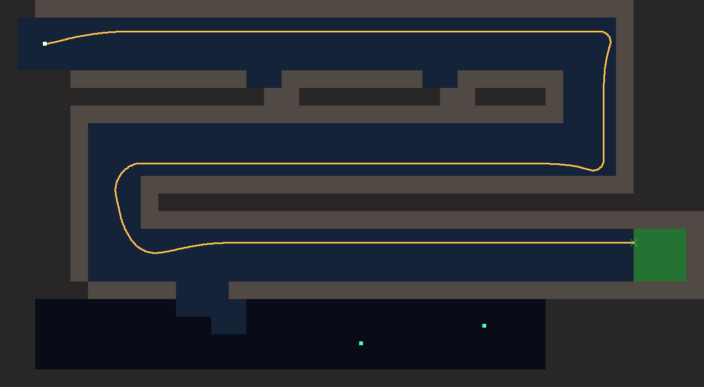
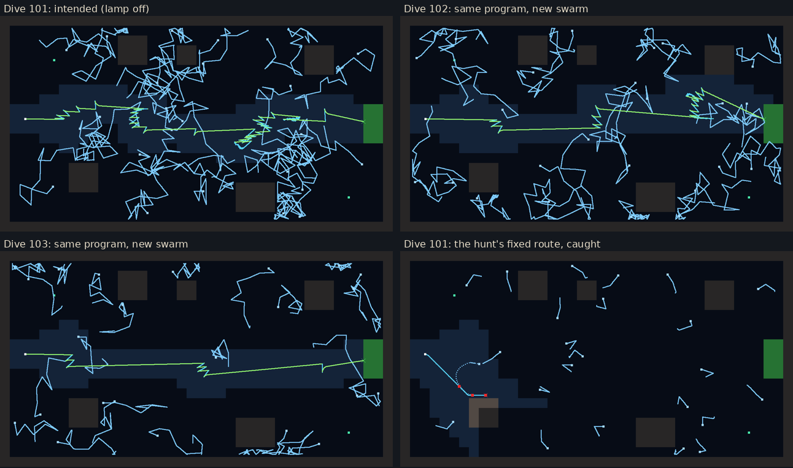
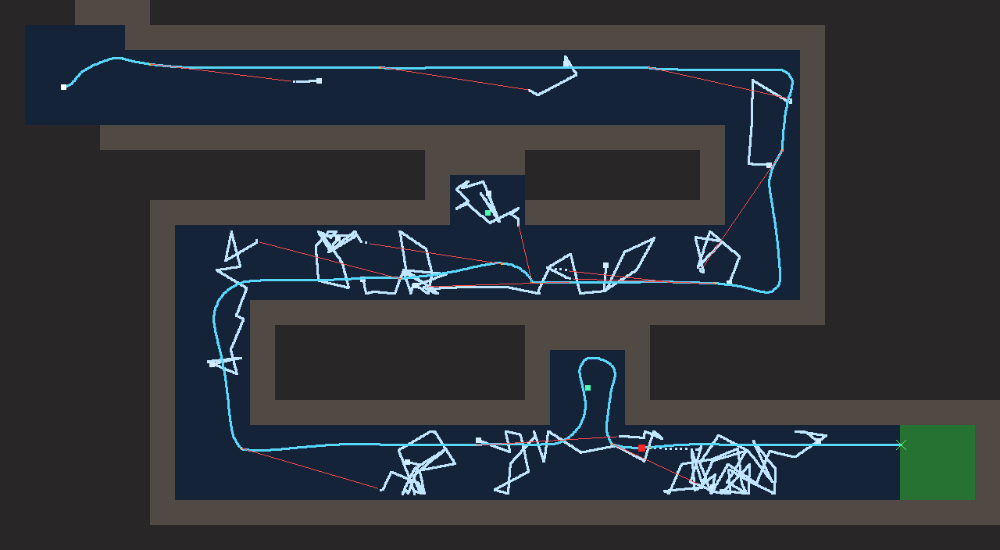
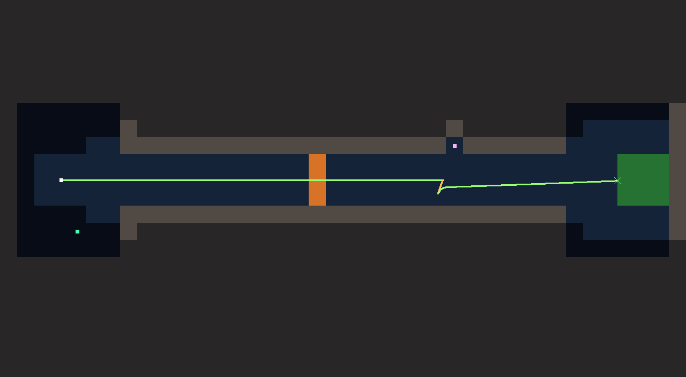
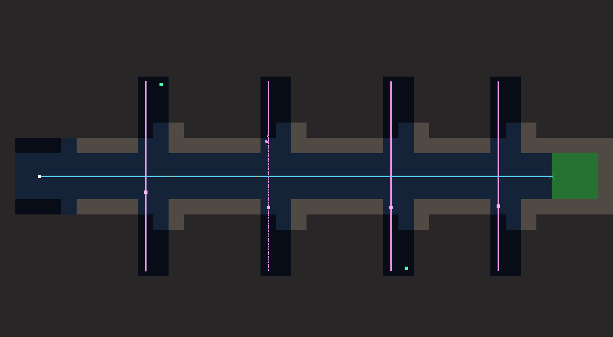

# The Jellyfish Rooms: prototype room designs

Five one-screen rooms (40 x 22 tiles, 1 tile = 1 m = 16 px) that share one set of orders.
Each has an intended solution, naive programs that must fail, and the idea it teaches.
Programs live in `game/content/programs/<room>/`; `tests/test_reference_programs.gd` checks every claim below.

Map key: `#` rock, `.` water, `S` start, `E` exit and beacon, `J` jellyfish, `L` lurker niche, `G` valve, `p` glowing plant.

## 1. The Dark

CPU budget 6 · energy 4200

```text
########################################
#..................................#####
#.S................................#####
#..................................#####
##############..########..######...#####
################################...#####
################################...#####
#####..............................#####
#####..............................#####
#####..............................#####
#####...################################
#####...################################
#####...################################
#####...............................EEE#
#####...............................EEE#
#####...............................EEE#
##########...###########################
##.............................#########
##.........................p...#########
##..................p..........#########
##.............................#########
########################################
```

**Teaches:** the beacon is not a path; following a wall is. Left and right are not the same.

| Program | CPU | Survey fleet (20 seeds) | What happens |
| --- | --- | --- | --- |
| `follow_wall left` (intended) | 3 | 20/20 | Out in 55 s with energy to spare |
| `follow_wall right` | 3 | 0/20 | Takes the big side cave, runs out of energy at 70 s |
| `move_towards beacon` | 2 | 0/20 | Crashes into the first wall three times |
| `move 90` | 1 | 0/20 | Same, slightly later |



## 2. The Jellyfish

CPU budget 8 · energy 6000 · swarm: 8 jellyfish resting by the rock plus 16 scattered fresh on every dive

```text
########################################
#................J.....................#
#.....J.....###............J...........#
#...........###...##...........###.....#
#....p......###...##...........###.J...#
#..............................###.....#
#......................................#
#......................................#
#......................................#
#....................................EE#
#.S..................................EE#
#....................................EE#
#....................................EE#
#......................................#
#......................................#
#......###..........................J..#
#......###.............................#
#...J..###..............####...........#
#.......................####.......p...#
#..............J........####...........#
#...........................J..........#
########################################
```

The `J` marks are the jellyfish that rest along the rock. Sixteen more are scattered over open water on
every dive (`jelly_scatter`: at least 6 tiles from the start, 3 from the exit, 2 from each other), so no
fixed route works twice. A lit lamp draws jellyfish from its beam and from a 3-tile glow all around Robbie
(`LAMP_HALO`), so sneaking past with the lamp on and the swarm behind you doesn't work either.

**Teaches:** light attracts. Darkness hides Robbie, and the jellyfish's own glow still warns it. Or: the loud way, with the laser.
One new idea after The Dark: a setting (the lamp). The hunt (block 6) showed that `lamp off` alone is enough; keeping
distance as well is the careful version, and costs more CPU. We tried making dark jellyfish notice Robbie up close
(block 6): it punished the careful program more than the simple one, because lingering near a jellyfish is worse than
swimming past it, so it was dropped.

| Program | CPU | Survey fleet (20 seeds) | What happens |
| --- | --- | --- | --- |
| `lamp off` / `move_towards beacon` (intended, simplest) | 3 | 20/20 | Swims straight through the dark; the scattered swarm rarely drifts into its path |
| `lamp off` / `move 90` | 2 | 20/20 | The same, knowing the exit is due east: the cheapest known solution |
| `lamp off` / `keep_distance 2` / `move_towards beacon` (intended, careful) | 6 | 18/20 | Slips through the swarm in the dark. Backing away is blind: twice in 20 a drifting jellyfish herds Robbie into rock |
| `lamp off` / `keep_distance 2 if not wall_behind` / `move_towards beacon` | 8 | 19/20 | The same, with a tail: "wall behind" (block 24) stops it backing into rock. Over 40 dives, 3 losses to rock become 1 |
| `shoot if hostile_near 4` / `move_towards beacon` (intended, loud) | 8 | 20/20 | Faster (about 20 s) but spends energy on every shot |
| `move_towards beacon` | 2 | 0/20 | Lit jellyfish dart at the lamp faster than Robbie swims |
| `keep_distance 2` / `move_towards beacon` | 5 | 0/20 | Backing away with the lamp on: the swarm follows |
| `follow_wall left` | 3 | 0/20 | Found by the exploit hunt (block 1): skirting the swarm along the rock. Jellyfish rest along the walls |
| `move 45 if energy_below 75` / `move 135` | 4 | 0/20 | Found by the exploit hunt (block 3): a fixed route that never looks. It passed 20/20 while the swarm sat still; now the swarm moves every dive |



## 3. The Nursery

CPU budget 8 · energy 7500 · 8 jellyfish resting in the tunnel plus 6 scattered fresh on every dive

```text
########################################
#....###################################
#.....................J.........########
#.S.........J...................########
#...............................########
#############################...########
#############################.J.########
##################...########...########
##################.p.########...########
#######.........................########
#######.................J.......########
#######.......J.................########
#######...##############################
#######...##############################
#######.J.############...###############
#######...############.p.###############
#######...############...###############
#######.............................EEE#
#######.........J...................EEE#
#######.....................J.......EEE#
########################################
########################################
```

A winding tunnel three tiles wide, with two dead-end pockets. Added in block 7.

**Teaches:** the laser. When there is no way round, clear the way. It reuses the first room's trick
(`follow_wall`), and it shows that the Jellyfish room's trick (`lamp off`) is not a universal answer: in a tunnel this
narrow, darkness doesn't stop Robbie swimming into a jellyfish that is resting in its way.

| Program | CPU | Survey fleet (20 seeds) | What happens |
| --- | --- | --- | --- |
| `shoot` / `follow_wall left` (intended) | 6 | 20/20 (39/40; 8/10 on the survey seeds) | Clears the tunnel shot by shot, about 55 s, roughly a fifth of the energy left. Now and then a hit at the C/D corner makes it lose the wall and lap the middle tunnel until the energy runs out |
| `shoot` / `follow_wall right` (intended) | 6 | 20/20 | Either hand works |
| `lamp off` / `shoot` / `follow_wall left` | 7 | 19/20 | Works, but the lamp makes no difference here (one energy failure) |
| `lamp off` / `follow_wall left` | 4 | 0/20 | The Jellyfish's answer: stung by the jellyfish resting in the tunnel |
| `follow_wall left` | 3 | 0/20 | The Dark's answer: same |
| `move_towards beacon` | 2 | 0/20 | Lit jellyfish, then the rock |
| `shoot` / `move_towards open_water` | 6 | 0/20 | Open water is not a way through a winding tunnel: walls and wasted energy |
| `shoot` / `move_towards beacon` | 5 | 0/20 | The beacon points through rock |



## 4. The Valve

CPU budget 10 · energy 6000 · valve cycle 60/45/150 ticks (open/closing/shut)

```text
########################################
########################################
########################################
########################################
########################################
########################################
#......##########################......#
#......##########################......#
#......###################L######......#
#.................G.................EEE#
#..S..............G.................EEE#
#.................G.................EEE#
#......##########################......#
#...p..##########################......#
#......##########################......#
########################################
########################################
########################################
########################################
########################################
########################################
########################################
```

**Teaches:** wait for the world; flinch from what wakes up. Sensing matters: Robbie only knows the valve is shut when it can see it ahead.

| Program | CPU | Survey fleet (20 seeds) | What happens |
| --- | --- | --- | --- |
| `keep_distance 4` / `stop if valve_shut` / `move_towards beacon` (intended) | 9 | 20/20 | Waits for the valve, backs off the lurker's glowing eyes, slips past while it rests |
| `keep_distance 4` / `move_towards beacon` | 5 | 5/20 | Ignores the valve: stung to death by it three times in four |
| `move_towards beacon if valve_open` / `stop if wall_ahead` / `move_towards beacon` | 10 | 0/20 | Waits perfectly, then swims straight into the lurker |
| `move_towards beacon` | 2 | 0/20 | Valve or lurker, whichever comes first |
| `shoot` / `move_towards open_water` | 6 | 0/20 | Found by the exploit hunt (block 6): shoot whatever wakes, otherwise explore (the shut valve looks like rock to the open-water sense, so it waits by accident). It passed the survey fleet at 6 CPU, cheaper than the intended 9, so **lurkers are now laser-proof**: the beam glances off, Robbie pays for the shot and stands still while the lurker strikes. The 10-CPU variant accepted in block 4 fails too |
| `keep_distance 4` / `move_towards open_water` | 6 | 9/20 (7/10 on the survey seeds) | Flinch and explore: close to certifying, wanders and runs out of energy too often |



## 5. The Listeners

CPU budget 7 · energy 4000 · four eels, each patrolling its own shaft across the corridor, starting anywhere in it

```text
########################################
########################################
########################################
########################################
########################################
#########.p######..######..#####..######
#########H.######..######..#####..######
#########..######..######H.#####..######
#########..######..######..#####..######
#....####..######..######..#####..######
#...................................EEE#
#.S.................................EEE#
#...................................EEE#
#....####..######..######..#####..######
#########..######..######..#####H.######
#########..######H.######..#####..######
#########..######..######..#####..######
#########..######..######.p#####..######
########################################
########################################
########################################
########################################
```

`H` marks an eel's shaft. Added in block 11, with a new creature.

**The eel ("listener")** is blind. It swims up and down its shaft at 0.9 px per tick, faster than Robbie can back away
(0.75). If Robbie is **moving** within three tiles and in line of sight, the eel hears it and lunges at 1.5 px per tick
for 2.5 s; a bite costs 2 hull. Then it swims back to its shaft and rests for 3 s. A Robbie that holds still is just
another rock to it. Its stripes glow, so Robbie senses it within four tiles in any light. It slips out of the laser.

**Teaches:** some things hunt by sound: stop and let them pass. It's the opposite of The Valve's lesson, where you
back away from the lurker. Backing away from an eel is still swimming. Range matters too: stopping at two tiles is too
late, because the eel hears at three.

| Program | CPU | Survey fleet (20 seeds) | What happens |
| --- | --- | --- | --- |
| `stop if hostile_near 4` / `move_towards beacon` (intended) | 6 | 20/20 | Holds still while an eel crosses, about 25–40 s |
| `stop if hostile_near 6` / `move_towards beacon` | 6 | 20/20 | Waits earlier and longer |
| `move 90 if not hostile_near 4` | 5 | 20/20 | Found by the hunt (block 12), cheapest known: when no rule applies Robbie drifts, which is as still as stopping. Same lesson, one rule |
| `move_towards beacon` | 2 | 4/20 | Only when every eel happens to be far up or down its shaft |
| `stop if hostile_near 2` / `move_towards beacon` | 6 | 1/20 | Too late: the eel hears at three tiles |
| `keep_distance 4` / `move_towards beacon` | 5 | 6/20 | The Valve's lesson: backing away is noise, and it backs into the corridor walls |
| `lamp off` / `move_towards beacon` | 3 | 4/20 | The eels are blind |
| `shoot` / `move_towards beacon` | 5 | 0/20 | Eels slip out of the beam |




## 6. The Lock

CPU budget 16 · energy 9000 · valve: open 60, closing 45, shut 150 ticks, phase varies per dive

```text
########################################
########################################
########################################
##########....#########..#####..########
##########....#########..#####..########
##########H...#########..#####..########
#......###....#########..#####.H########
#......###....#########..#####..########
#......###....#########..#####..########
#.................G.................EEE#
#..S..............G.................EEE#
#.................G.................EEE#
#......###....#########..#####..########
#.p....###....#########..#####..########
#......###....#########..#####..########
##########....#########.H#####..########
##########...H#########..#####..########
##########....#########..#####..########
########################################
########################################
########################################
########################################
```

Added in block 23. No new creature: the first room that needs two earlier lessons at once.
A wide shaft with two eels before the valve, two more shafts after it.

**Teaches:** combine answers. The eels need Robbie to hold still while one is near (The Listeners); the valve needs
Robbie to wait while it is shut (The Valve). Each room's own answer fails here on its own.

| Program | CPU | Survey fleet (20 seeds) | What happens |
| --- | --- | --- | --- |
| `stop if hostile_near 4` / `stop if valve_shut` / `move_towards beacon` (intended) | 10 | 18/20 | Out in about 30 s. Twice an eel lingers in range and Robbie waits until its battery runs out |
| `keep_distance 4` / `stop if valve_shut` / `move_towards beacon` | 9 | 5/20 | The Valve's answer: backing away is noise, and it backs into rock |
| `stop if hostile_near 4` / `move_towards beacon` | 6 | 8/20 | The Listeners' answer: crushed in the valve |
| `stop if valve_shut` / `move_towards beacon` | 6 | 8/20 | Waits for the valve, then swims past the eels |
| `move_towards beacon` | 2 | 2/20 | Crushed or bitten |
