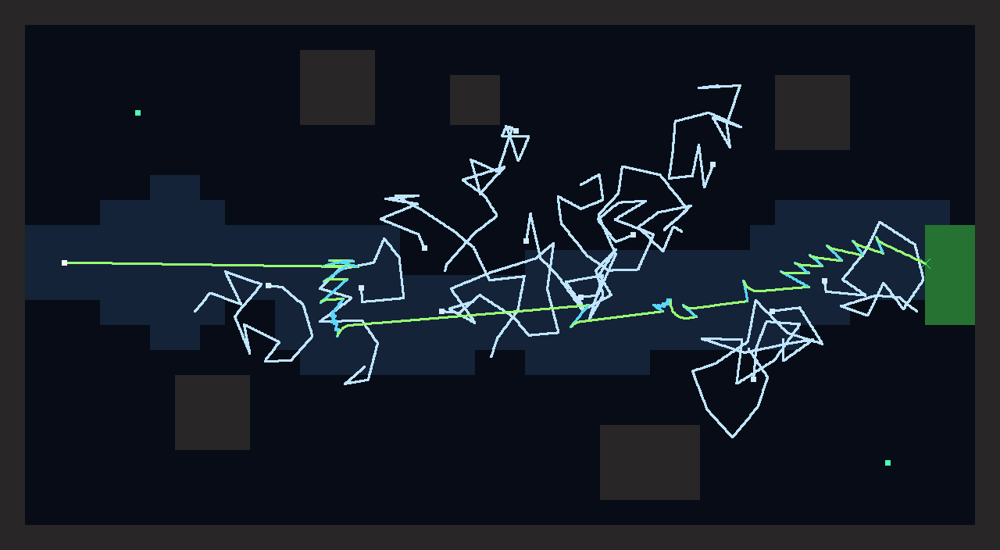
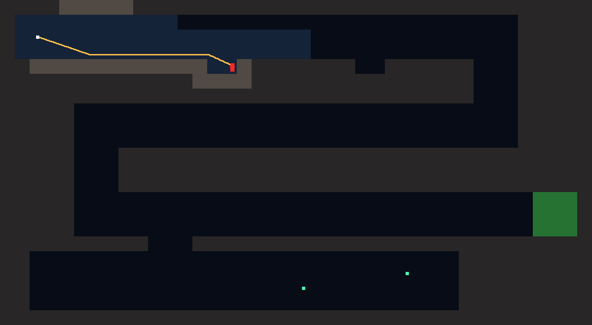
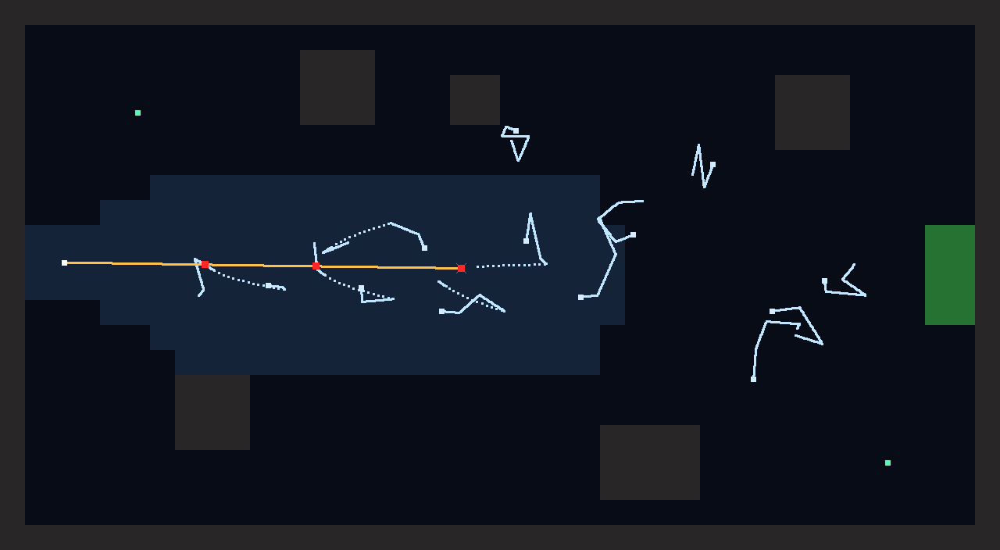
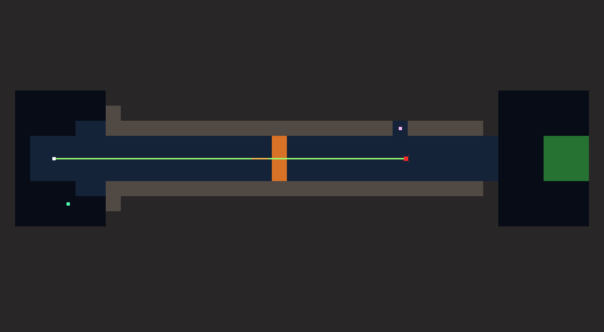
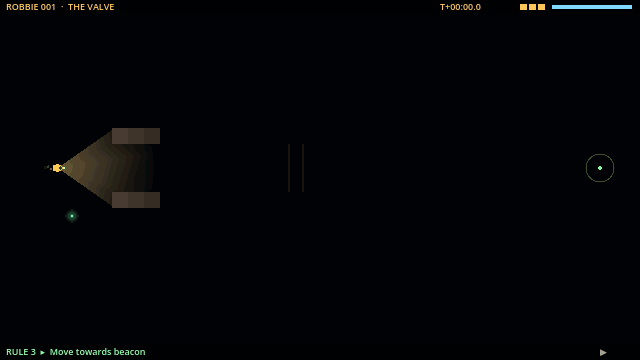

# Session 1 — 2026-10-16: foundations and the sim in a terminal

**Goal:** M0 (repo, tooling, tests) and P0a (the deterministic simulation, with the three
prototype rooms designed on paper and checked by reference programs).

## What got built

- Repo skeleton, `CLAUDE.md`, pinned Godot 4.7.2 with checksum, bootstrap and helper scripts, CI workflow.
- `game/sim/`: integer maths (`Fx`, generated trig tables), xorshift generator (`Rng`, cross-checked
  against Python), room loader, world simulation, recorder, dive, survey fleet.
- `game/vm/`: order catalogue with CPU costs, program parser with friendly errors, interpreter with trace,
  plain-words explanations of each think.
- Tools: `dive.sh` (JSON outcome, `--trace`, `--png`, `--dump`), `certify.sh`, `bless.sh`, exploit hunt.
- 25 tests. Golden replays for every reference program on two seeds.

## The rooms, as the simulation sees them

| The Dark: `follow_wall left` | The Jellyfish: lamp off, keep distance, beacon | The Valve: flinch, wait, go |
| --- | --- | --- |
|  |  |  |
|  |  |  |
| The beacon is not a path: three crashes | Lamp on: stung by darting jellyfish | Waited for the valve, ignored the lurker |

The path colour shows which rule was driving Robbie; red squares are hits; the X is where the dive
ended. Lit tiles are what the station would know about afterwards.

## What the tests taught us (design changes made today)

1. **An island on the beacon line** made the jellyfish room about walls, not jellyfish. Moved it.
2. **The right-hand wall in The Dark** also reached the exit. Energy cut from 7,000 to 4,200, so the
   long way runs dry: left and right now matter.
3. **The lurker sat too far from the path** and never woke. Corridor narrowed to three tiles,
   lurker made lethal, warning stretched to 0.5–0.67 s, and visible in the lamp while it winds up.
4. **Turning around to flee was too slow.** `keep_distance` now backs away while facing the threat
   (0.75 px per tick). It reads better too: Robbie keeps its light on what scares it.
5. **"Stop if wall ahead" froze Robbie for three minutes** after a flinch left it facing rock. A
   wonderful death, but it broke the intended solution, so `valve is shut` joined the conditions.
   It only counts a valve Robbie can sense ahead, and never one it is inside, so Robbie can't stop
   inside a closing valve.
6. **Ignoring the valve passed too often** (7/10). The shut valve now stings, the open window is
   shorter, and that program passes 5/20, so it fails the survey fleet.
7. **Speed:** a dive simulates in about 0.1 s, so 240 dives took 33 s. The solver is very feasible.

## Exploit hunt, first results

The hunt tries every one-rule program and every two-rule program whose second rule is unconditional,
within the room's CPU budget, on three seeds.

- **The Dark:** 4,046 programs tried. Nothing cheaper than `follow_wall left` (3 CPU). The most
  interesting alternative is a two-rule bounce, `move 225 if wall_ahead` / `move 90` (4 CPU): it
  zigzags down the snake. That's a clever solution rather than an exploit, so it stays.
- **The Jellyfish and The Valve:** still running when this was written.

## Decisions taken with recommended defaults (Albert can still change them)

- A level is certified by a survey fleet of 10, at least 8 must make it.
- Single dives are free but counted.
- Distances shown to players in metres; one tile is one metre.

## Bonus: the first replay view (start of P0b)

The replay player draws a recording the way Robbie's camera saw it: black water, the lamp cone
computed with the sim's own rays, glowing jellyfish, the lurker's eyes, the valve, the beacon, and the
station's memory of rock already seen. The bottom line shows the rule driving Robbie at that moment.

## Next session

Rest of P0b: VCR controls on screen, the click-built rule editor, the launch → watch → edit loop,
and a web build Albert can open.
