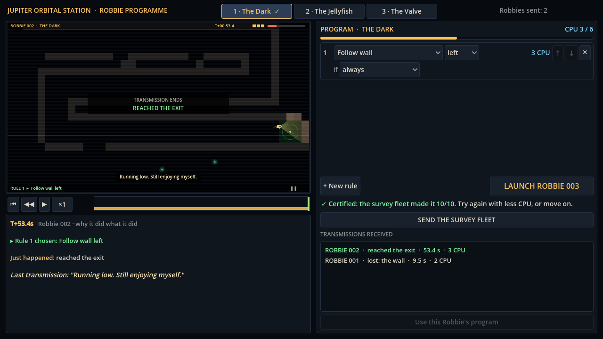
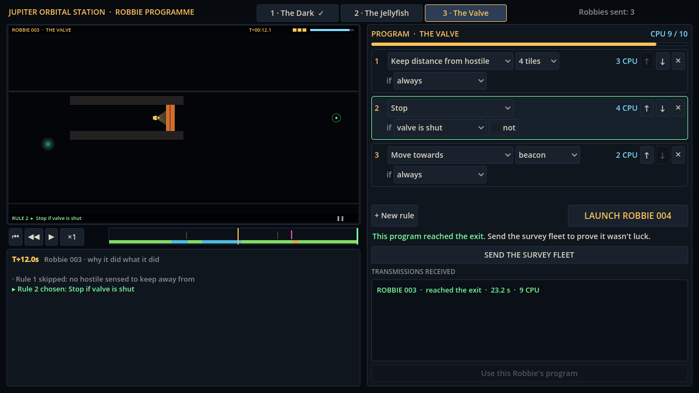

# Session 2 — 2026-10-16 (evening): the station, the first playable loop

Albert's direction: forget GitHub for now, keep improving, work in hourly blocks.

## What got built

- **The station screen** (1280×720): the monitor shows the transmission; transport buttons and a
  timeline with markers (hits, the lurker waking, laser shots, the valve shutting) and click-to-seek;
  a **Why? panel** that explains, in words, what Robbie checked at its last think before the playhead.
- **The rule editor**, click-built as the concept describes: order, parameter, then `if` / `not` /
  condition, with each rule's CPU cost, a CPU meter against the room's budget, reorder and delete.
  The rule driving Robbie lights up green while the replay plays.
- **Launch → watch → edit → relaunch**, each Robbie numbered; **survey fleet** and certification;
  the list of transmissions with each Robbie's last words on hover; restore any Robbie's program.
- **Robbie's voice v1:** 40 lines in `game/content/voice/lines.json` (editable without code):
  launch lines, first jellyfish, the lurker's eyes, first hit of each kind, low energy, the exit,
  last words by cause, and "same death as the previous Robbie" lines.
- **Builds:** Linux, Windows, macOS, and a web build hosted as a private claude.ai page.
  The web engine is 39.5 MB; pages allow 15 MB per file and only web file types, so the engine
  ships gzipped inside a script file and the page unpacks it in the browser (`tools/web_artifact.sh`).

| Certified room | Waiting at the valve |
| --- | --- |
|  |  |

## Fixed along the way

- The last transmission sometimes showed a low-energy remark instead of the final words.
- Symbols (▶, ↑, ✕) rendered as empty boxes in the web build: it has no system fonts. Icons are now
  drawn as shapes; the HUD uses plain text.
- The "transmission ends" card covered the place where Robbie died; it now sits at the top.

## Notes for next blocks

- The web page is untested inside the claude.ai frame (tested in headless Chromium). If the frame
  blocks WebAssembly, fall back to the desktop zips.
- The exploit hunts for The Jellyfish and The Valve are re-running at low priority.
