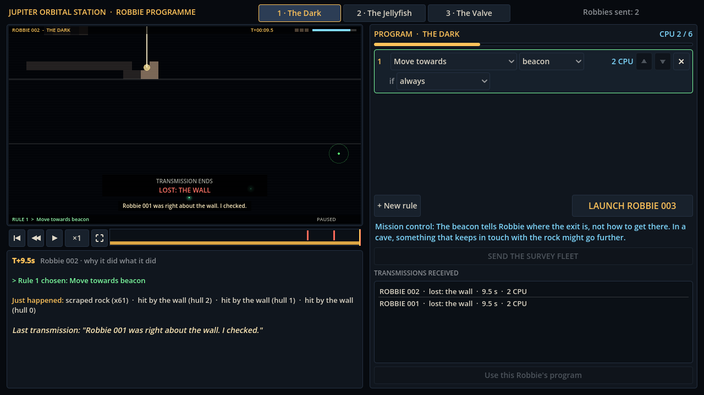
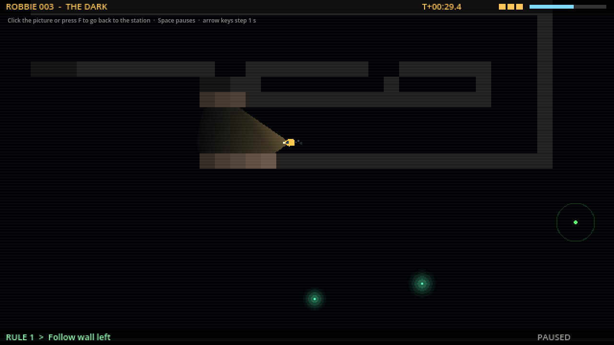

# Block 1 — 2026-10-16, 22:38 UTC: watching and learning

First hourly block. Picked what most helps a first-time player: seeing the dive properly, seeing
what earlier Robbies learned, and getting a nudge when stuck.

- **Watch large** (F, or the corner button by the speed control): the transmission fills the
  window at 2x, pixels intact. Click it or press F to return.
- **The station's chart:** the replay now shows, very faintly, rock and water that earlier Robbies
  in this room had already seen. It is built from what each Robbie saw *before* the one being
  replayed, so a replay never shows its own future.
- **Mission control:** hints in `game/content/voice/hints.json`. A first line on the first visit,
  a "scrub the timeline" line after the first loss, and room-specific nudges after two Robbies are
  lost the same way (never the answer).
- **Why? panel:** repeated events collapse ("scraped rock (x61)").
- **End card** moves away from where Robbie ended.
- **Exploit hunt** is now resumable (`tools/hunt.sh`): the container restarts between blocks
  and was killing hunts that take more than an hour.

| Mission control after two crashes | Watch large, with the faint chart |
| --- | --- |
|  |  |
