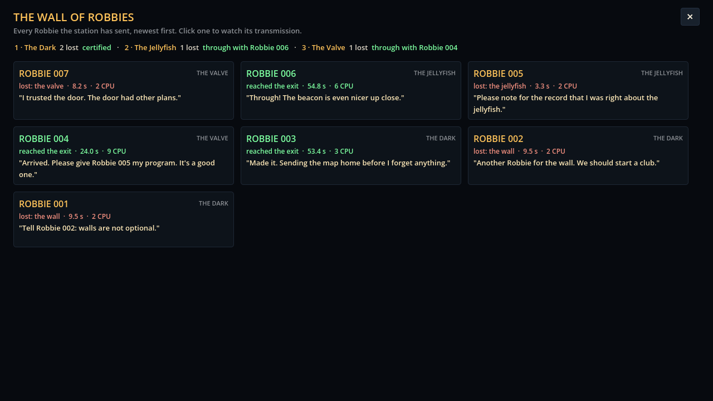

# Block 4 — 2026-10-17, 02:18 UTC: the Wall of Robbies

## The Wall of Robbies

The header's "Robbies sent" counter is now a button (or press W). It opens a full-screen wall with a plaque
for every Robbie the station has sent, newest first:

- the serial, in amber if it was lost and green if it reached the exit, and the room it went to;
- how it ended, how long it lasted and how much CPU its program used;
- its last words, as an epitaph.

The top line keeps the score for each room: how many Robbies it has cost, and whether it is certified or which
Robbie got through first. Lost survey Robbies get plaques too, placed just after the Robbie whose program they
tested; they don't send last words, and the plaque says so. Clicking a plaque goes to that room and plays the
transmission from the start. W or Esc goes back.

## More last words

With every epitaph side by side, the old pools were too small (three lines for an exit, so Robbie 003 and
Robbie 006 said the same thing). 36 new lines: every ending now has 7 or 8, and "same death as the last one"
has 6. Same voice as before: helpful, literal, a little naive. One lurker line ("Something in the rock was
waiting. It was very patient.") is as close as the game gets to the story for now.

## Small fix found while looking

Watching an older Robbie whose program differs from the one in the editor used to light up the editor's rules by
number, which pointed at the wrong rule (or at nothing). Now the editor only lights up when it holds the same
program, and the Why? panel says "This Robbie ran a different program from the one in the editor" with the button
to load it.

## The Valve hunt finding: accepted

The hunt found `move_towards open_water if not hostile_near 4` / `shoot` (10 CPU): 12/20 dives and 8/10 on the
real survey seeds, so it certifies. I looked at it and kept it. It does engage with the room: it shoots the lurker
when it wakes, and its open-water sense treats the shut valve as rock, so it waits without meaning to. It costs the
whole budget, more than the intended program (9). Logged in `rooms.md` as the loud way, alongside the laser in
The Jellyfish. The future CPU histograms will show players there is a cheaper way.

## Also

- `tests/test_wall.gd`: plaque order and the per-room score. `GameState.persist` lets tests run without touching
  the save file. 31 tests green.
- The station screenshot tour (`tools/shots.tscn`) now opens the wall and clicks a plaque.
- Both hunts restarted (the container had restarted and stopped them).
