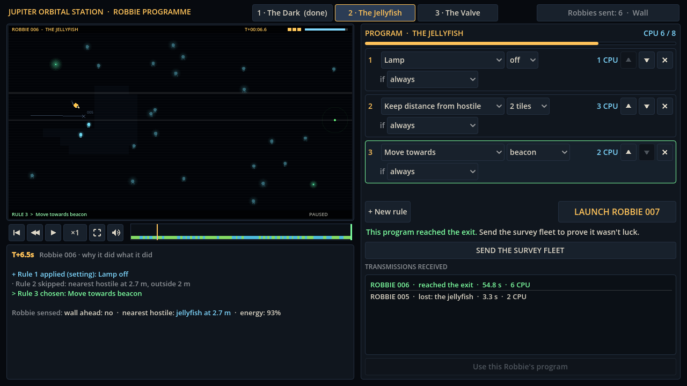
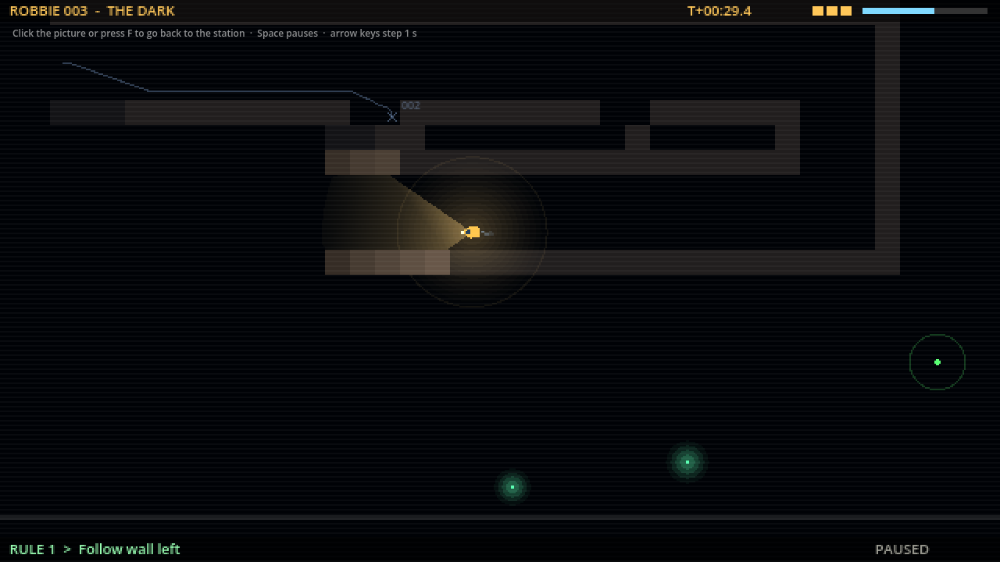

# Block 5 — 2026-10-17, 03:31 UTC: what Robbie sensed, and the ghost of the last Robbie

Two small features for the "understand, then fix" half of the loop.

## Robbie sensed: …

The Why? panel used to say only which rule ran and why the others were skipped. With a one-rule program, that is
one line: "Rule 1 chosen: Move towards beacon". It now adds what Robbie's sensors read at that moment, in the same
words the conditions use:

> Robbie sensed: wall ahead: **yes** · nearest hostile: jellyfish at 2.7 m · valve ahead: **shut** · energy: 86%

A reading that would make its condition true is lit in cyan. The idea is that a player stuck on The Dark scrubs to
the crash, reads "wall ahead: yes", and finds "wall ahead" in the condition list. The panel teaches the vocabulary in
context instead of in a manual. "Nearest hostile" only appears in rooms with creatures and "valve ahead" only in rooms
with a valve.

The readings are recorded at each think only for dives the station shows (`Vm.record_senses`). Survey fleets,
hunts and tests skip them, because reading every sensor on every think made a 20-dive fleet much slower. A new test
checks that recording them never changes a dive (same final hash).

## The ghost

Each Robbie's route is now kept in the save file (a position every 6 ticks, about 1.5 KB per Robbie). When you watch
a Robbie, the previous Robbie in the same room swims alongside it as a ghost: a faint blue trail, a small ring with its
number where it is at that moment, and a cross where it was lost. You can watch Robbie N+1 take a different turn
from Robbie N, or see that it died in the same place.

Robbies saved before this block have no route, so they have no ghost.

## Also

- The station tour takes a screenshot with a ghost in it (`08b-jellyfish-ghost`).
- 33 tests green (new: senses don't change dives; the ghost is the previous Robbie in the same room, and its path
  starts and ends where that Robbie did).
- Hunts restarted again. The Valve hunt is past 7,200 of about 7,600 programs, with no new findings. The Jellyfish
  hunt is slower (dark dives are long), at about 1,000.
