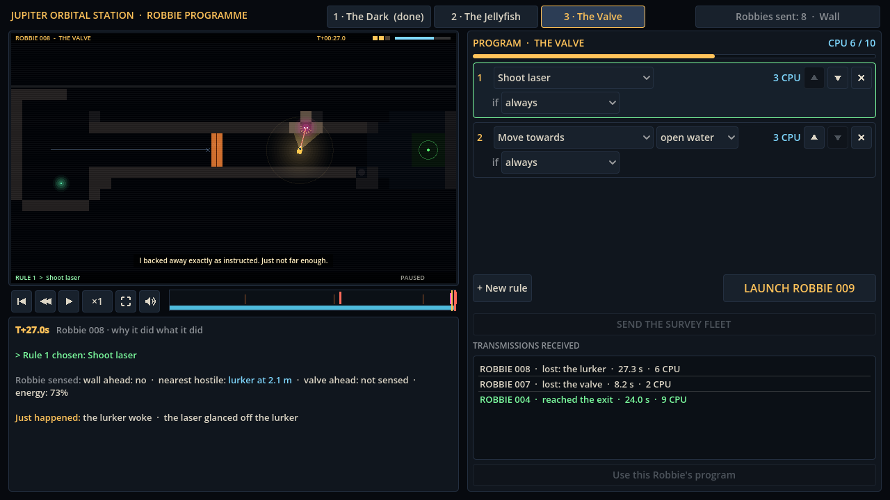

# Block 6 — 2026-10-17, 04:40 UTC: the hunts finish their sweep; lurkers are laser-proof

The Valve hunt finished overnight (8,420 programs) and The Jellyfish hunt passed 2,000. Both found programs cheaper
than ours.

## The Valve: "shoot anything, otherwise explore" (6 CPU)

Twelve passing programs, all variations of one idea: `shoot` when anything is in range, otherwise
`move_towards open_water`. Two things combine:

- Shooting the lurker the moment it wakes kills it.
- The open-water sense treats a shut valve as rock, so Robbie turns away and wanders the chamber until the valve
  opens. It waits for the valve by accident.

The cheapest one cost 6 CPU, against 9 for our intended program. It passed only 12 of 20 dives in general, but 8 of
the 10 fixed survey dives, enough to certify. In block 4 I had accepted its 10-CPU cousin as "the loud way". At 6 CPU it
skips both of the room's lessons (flinch from the lurker, wait for the valve), so it's out.

**The fix: lurkers are armoured rock.** The laser still fires at a waking lurker (Robbie can't tell it's pointless
until it tries), but the beam glances off in a shower of sparks. Robbie pays the energy, stands still for the shot,
and the lurker strikes. Robbie has a new line for it ("The rock is laser-proof. Noted."), and the Why? panel says
"the laser glanced off the lurker".

Every laser program from the hunt now passes 0 of 20 dives. The intended program is unchanged at 20/20. The new
reference program `valve/naive_laser.rbt` must fail. Different creatures now need different answers: jellyfish can
be shot or hidden from, lurkers can only be avoided.

## The Jellyfish: the lamp is the whole lesson

The hunt found `move 90 if energy_below 50` / `lamp off` (4 CPU), which turned out to be "lamp off, go east". Checked
directly:

| Program | CPU | 20 dives |
| --- | --- | --- |
| `lamp off` / `move_towards beacon` | 3 | 20/20 |
| `lamp off` / `move 90` | 2 | 20/20 |
| `lamp off` / `keep_distance 2` / `move_towards beacon` (our intended) | 6 | 18/20 |

So keeping distance isn't needed, and in fact it costs two dives in twenty (backing blindly into rock).

I tried to make it needed. Dark jellyfish notice Robbie up close (1.5 to 2.5 tiles) and drift over for a look. It
backfired: the straight swimmer still passed 15/20, while the careful program fell to 3/20 and then 0/20, because
keeping your distance means lingering near a jellyfish, and lingering is what gets you stung. Reverted.

I think this is the right outcome anyway. The Dark teaches one idea (follow the rock), The Jellyfish teaches one idea
(light attracts, so turn the lamp off), and The Valve combines two (wait, flinch). The simplest lamp-off program is now
the reference solution (`jellyfish/intended_lamp_off.rbt`). The careful one stays, also certified.

## Also

- A replaced last line: "I backed away exactly as instructed. Just not far enough." was said by Robbies that never
  backed away. It became "The rock moved. Rocks are not supposed to move."
- The station tour captures the laser bounce (`08c-laser-bounce`).
- 34 golden replays (4 new; the existing 30 unchanged). 33 tests green.
- The Jellyfish hunt resumed; the Valve hunt's result list is now historical (every entry used the laser).
