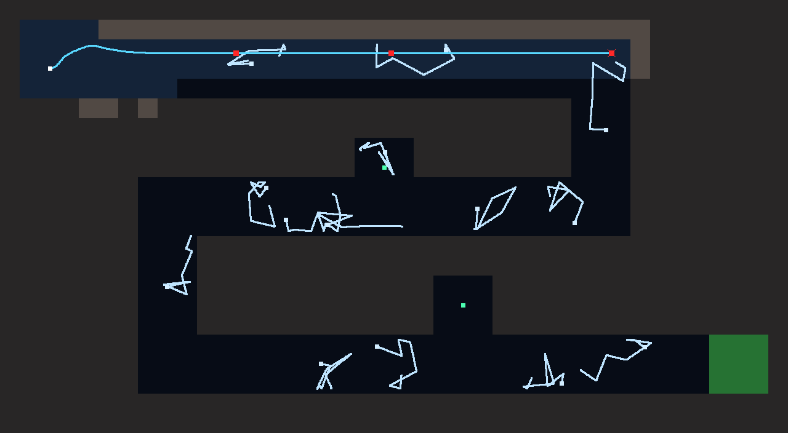

# Block 7 — 2026-10-17, 05:50 UTC: a fourth room, The Nursery

The prototype had three rooms, each teaching one idea. The laser existed but no room needed it: in The Jellyfish it's
the loud alternative, and in The Valve it now glances off the lurkers. The backlog asked for "one room that rewards
the laser". This is it.

## The room

A winding tunnel, three tiles wide, from the top-left to the bottom-right, with two dead-end pockets. Eight
jellyfish rest in the tunnel, and six more are scattered fresh on every dive, so no two dives are the same.

It is placed third, before The Valve, so the order is:

1. **The Dark:** follow the rock.
2. **The Jellyfish:** light attracts, so turn the lamp off.
3. **The Nursery:** when there is no way round, clear the way. It reuses room 1's trick and shows that room 2's isn't
   universal.
4. **The Valve:** conditions. Wait for the valve, flinch from what you can't shoot.

The design point I like most is that both earlier solutions fail here on purpose. `follow_wall left` (The Dark's
answer) and `lamp off` / `follow_wall left` (The Jellyfish's answer) both pass 0 of 20, because darkness doesn't stop
Robbie swimming into a jellyfish resting in its path. The fix is one rule: `shoot` above `follow_wall`, 6 CPU, 20/20.

Measured with 20-dive fleets, energy set so the intended program finishes with about a fifth left (all programs
that get through use about 6,000 of 7,500, whether they shoot everything or only what's close). The full table is in
`rooms.md`.

## Station changes

- Four room tabs. Certified rooms turn green instead of saying "(done)", which no longer fit.
- Room names come from the room files, so a new room is a `.room` file plus one line in `GameState.ROOMS`.
- Mission-control hints for The Nursery (stung twice: "the dark won't keep them out of Robbie's way"; stung four
  times: the laser; crashed: "the trick from the first room still works here"; out of energy).
- The station tour photographs The Nursery (`08d`, `08e`, `08f`) and finds the lurker moment by its event instead
  of a fixed tick, since The Valve's practice seed changed with its position (201 → 301).

## Also

- 46 golden replays (12 new; the existing 34 unchanged). 33 tests green.
- A Nursery exploit hunt started in the background.
