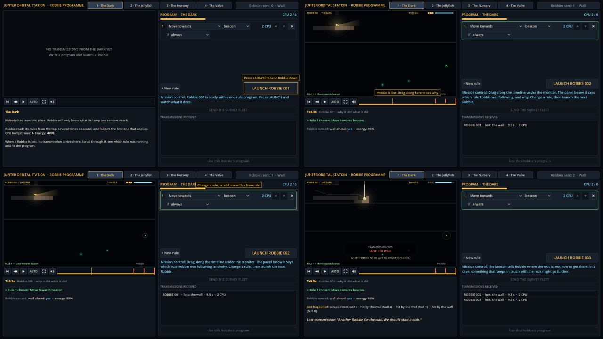

# Block 9 — 2026-10-17, 08:10 UTC: a first-visit coach; hunts re-check their findings

## The coach

The last open item of P0b (the first playable) was "point at the editor on the first visit". The station already
greets a new player with a broken one-rule program and mission-control lines, but nothing on screen said *where* to
click. Now a pulsing amber outline and a short label point at the one control to use next:

1. **"Press LAUNCH to send Robbie down"** on the LAUNCH button, before the first Robbie.
2. **"Robbie is lost. Drag along here to see why"** on the timeline, until the player drags it.
3. **"Change a rule, or add one with + New rule"** on the program, until it changes.
4. **"Send the next Robbie"** on LAUNCH again.

Once Robbie 002 is sent (or Robbie 001 somehow makes it) the coach is done for good, and that is saved. Saves from
before this block count as done if they have sent any Robbie. It hides while the Wall or the large view is open.

The mission-control text below the LAUNCH button says the same thing in more words; the coach is the "here".

## Hunts re-check their findings

A resumed hunt now re-runs every program on its saved list before continuing, and drops the ones that no longer pass.
The Valve's list had twelve laser programs that stopped passing in block 6; it's now empty. The Valve sweep, including
the fall-through pairs added in block 8, is finished, and nothing on it passes now.

## Also

- The station tour shows the coach's editor step (`02b-coach-editor`).
- 34 tests green.
