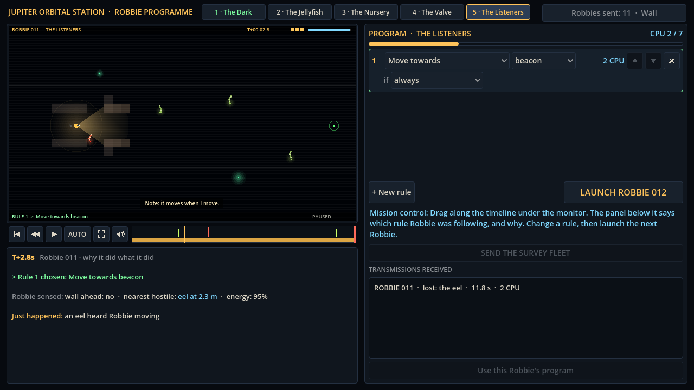

# Block 11 — 2026-10-17, 10:25 UTC: a new creature and a fifth room, The Listeners

## The eel

The first four rooms have two creatures: jellyfish (light attracts them) and lurkers (rock with eyes; back away).
The third is the **eel**, the listener:

- It is blind. It patrols up and down its own shaft, a little faster than Robbie can back away.
- If Robbie is *moving* within three tiles and in line of sight, it hears it and lunges (1.5 px per tick for 2.5 s; a
  bite costs 2 of Robbie's 3 hull). Then it swims back to its shaft and rests.
- If Robbie is *still*, the eel swims right past. A Robbie that holds still is just another rock.
- Its stripes glow, so Robbie can sense it within four tiles in any light. It slips out of the laser's beam.

On screen it's a short glowing body with three bright stripes, pale green while patrolling and red-eyed while
lunging. "An eel heard Robbie moving" shows up in the Why? panel and as a green-yellow marker on the timeline, with a
higher-pitched growl. Robbie has new lines ("Something heard me." "Note: it moves when I move.") and eight last words,
among them "Swimming is noisy. Who knew."

## The Listeners

A straight corridor crossed by four shafts, one eel in each, starting anywhere in its shaft on every dive. The beacon
is straight ahead, so steering isn't the puzzle: timing is.

**Lesson:** some things hunt by sound, so stop and let them pass. It's deliberately the opposite of The Valve, where
the answer to the lurker was to back away. Here backing away is still swimming, and the eel is faster than Robbie in
reverse. Range matters as well: `stop if hostile_near 2` is too late, because the eel hears at three tiles.

| Program | CPU | 20 dives |
| --- | --- | --- |
| `stop if hostile_near 4` / `move_towards beacon` | 6 | 20/20 |
| `stop if hostile_near 6` / `move_towards beacon` | 6 | 20/20 (slower) |
| `move_towards beacon` | 2 | 4/20 |
| `stop if hostile_near 2` / `move_towards beacon` | 6 | 1/20 |
| `keep_distance 4` / `move_towards beacon` | 5 | 6/20 |
| `lamp off` / `move_towards beacon` | 3 | 4/20 |
| `shoot` / `move_towards beacon` | 5 | 0/20 |

The first layout (three long shafts) let the naive program through half the time: the eels were often far up or down.
Shorter shafts and a fourth eel brought that down to 4/20.

One thing I noticed while watching: an eel that hears Robbie from inside its shaft lunges diagonally and bumps into
the shaft's edge, so the shafts are a little safer than the open corridor. That reads as "it hit the rock", and the
room plays well with it, so I left it.

## Also

- Five room tabs (a little narrower). The Listeners comes fifth, after The Valve.
- The solver now counts evaluations cumulatively per room and runs the least-searched rooms first, so a restart never
  repeats work. The Jellyfish hunt is retired (it only finds lamp-off variants now); a Listeners hunt has started.
- 60 golden replays (14 new, the rest unchanged). 35 tests green.
