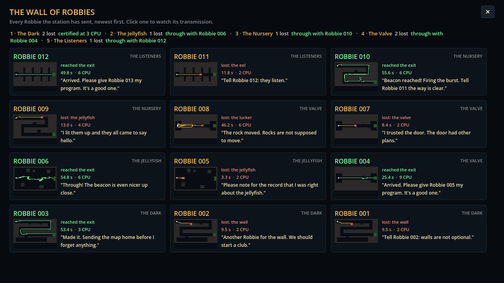

# Block 12 — 2026-10-17, 11:36 UTC: routes on the Wall, a render smoke test, and a cheaper Listeners solution

## Routes on the Wall of Robbies

Every plaque now has a small map of its room with that Robbie's route on it: amber with a red cross where it was lost,
green when it reached the exit. The routes come from what the station already saves (block 5), so it costs nothing
extra. Survey Robbies and Robbies from before block 5 show the room without a route. The score line at the top now
wraps onto two lines, since five rooms didn't fit on one.

## A render smoke test

`tools/smoke.sh` runs the scripted station tour under a virtual display and checks every screenshot is there, the
right size and not blank, and that no script error was logged. The headless tests never draw anything; this covers
the part they can't see. It runs in about 15 seconds; from now on it runs before every publish.

## The hunt found a one-rule Listeners solution

`move 90 if not hostile_near 4` (5 CPU) passes 20/20. When no rule applies, Robbie drifts, and drifting is as still
as stopping, so this is the room's lesson in one rule instead of two. It's now the room's "cheapest known" (5 against
our 6). The solver also starts from the hunt's findings now, which is how it picked this one up.

Records so far: The Dark 3, The Jellyfish 3, The Nursery 6, The Listeners 5 (The Valve still to come).

## Also

- The Nursery's left-hand solution is 39/40 in general but only 8/10 on the survey seeds. Now and then a hit at a
  corner makes it lose the wall and lap the middle tunnel until the energy runs out. It still certifies; noted in
  `rooms.md`.
- Gotcha: tool scripts need absolute paths for their output files (noted in CLAUDE.md).
- 35 tests green, smoke test green.
