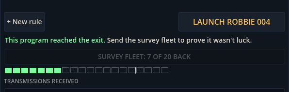

# Block 13 — 2026-10-17, 12:46 UTC: a fleet of twenty, sent out one by one

## Survey luck was real

The solver found `keep_distance 4` / `move_towards open_water` for The Valve: 6 CPU, against 9 for our intended
program. It passed 8 of the 10 survey dives, so it certified, but on twenty other seeds it got through only 9 times.
It was a coin flip that happened to land well on the survey's ten seeds. This had been in the backlog as "survey luck"
since block 6; now it had produced a fake record.

**The survey fleet is now 20 Robbies, and 16 must make it** (the same 80%). The arithmetic: a program that gets
through half the time passes 8 of 10 about one time in 18, but 16 of 20 less than one time in 150. One that gets
through 90% of the time passes 16 of 20 nineteen times in twenty. Every reference program still behaves as
documented at the new seeds (1001–1020), including the borderline ones.

## Sending the fleet without freezing the station

Twenty dives in The Nursery take about 7 seconds to simulate here, and longer in a browser. The station used to run
the whole survey in one go and freeze. Now the fleet goes out a few Robbies per frame: the button reads "SURVEY FLEET:
7 OF 20 BACK", and a strip of twenty squares fills in, green for each Robbie that made it and red for each one lost,
with a thin amber mark at sixteen. The station stays usable meanwhile. If you switch rooms, the result is saved to the
room it belongs to. A chime or a static burst plays when the last one is back.

## Also

- `Survey.Run` (one survey in progress, one dive per step) and `Survey.certifies()` (stops as soon as the verdict is
  certain: the reference test checks all 30 reference programs in about a minute).
- The solver keeps near-misses within four passes of the mark as starting points, and re-checks every earlier find
  against the new fleet when it restarts.
- The station tour photographs the fleet mid-survey (`06a-survey-out`). Smoke test green, 35 tests green.
