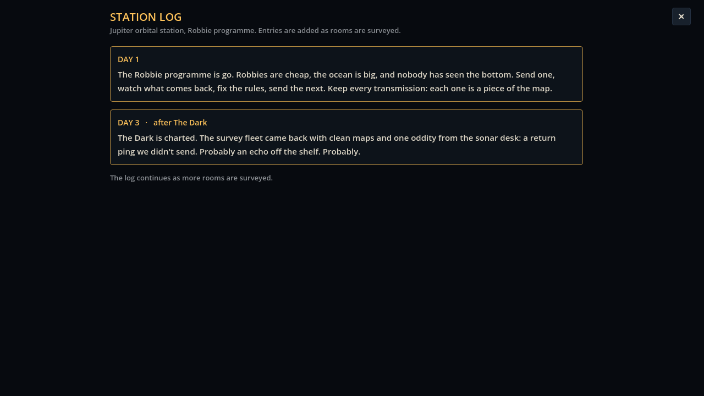

# Block 14 — 2026-10-17, 13:57 UTC: the station log, where the story starts

Albert's direction from the first session: something down there is watching the Robbies and learning too, and the
story should develop slowly. Until now the game had no place for a story at all. It has one now.

## The station log

A **Log** button sits next to the Wall in the header (or press L). It opens the station's log: short, dated entries
written by the people running the programme. The first is there from the start. One more is added each time a room is
certified, so the story moves at the player's pace and never interrupts a dive. When there's an entry you haven't read,
the button turns amber and counts it ("Log +1"), and the status under LAUNCH says so after a certification.

The six entries so far, in order: Day 1 (the programme), then after The Dark, The Jellyfish, The Nursery, The Valve and
The Listeners. They're understated on purpose. Each says one small thing the crew can't quite explain:

- a return ping on the sonar that nobody sent;
- a jellyfish swarm that drifts towards where Robbies went down;
- a low tone from below after the Nursery is cleared, three times;
- a valve rhythm that might have shifted after the tenth dive;
- the unexplained ping coming back a little closer after every lost Robbie.

None of it is mechanical yet. It's all words, in `content/story/log.json`, which Albert can rewrite freely; the plan
is for later rooms to start making some of it true.

## Also

- Records now only count programs certified by the 20-dive survey. Until the solver has re-checked each room
  (it's doing that in the background), only The Listeners shows a "cheapest known".
- `GameState.log_read` is saved; a reset clears it.
- The station tour photographs the log (`06c-station-log`). Smoke test green; 35 tests green.
