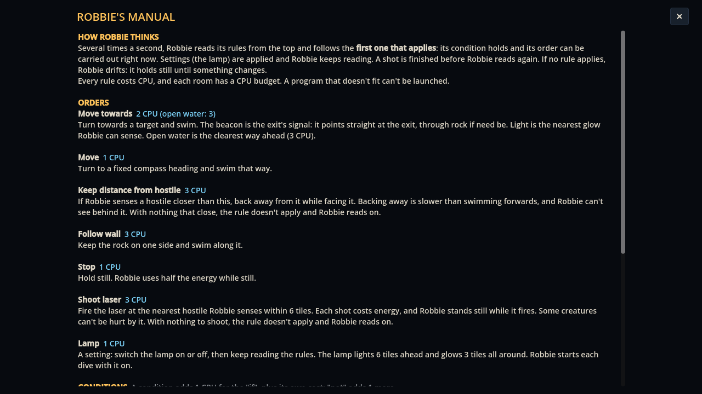

# Block 16 — 2026-10-17, 16:21 UTC: Robbie's manual, and help on every order and condition

## The problem

The editor offered seven orders and six conditions by name only. "Keep distance from hostile 4 tiles" or "Move towards
open water" don't explain themselves. What does Robbie count as sensing? Does keeping distance back away or turn
round? What happens when no rule applies? The answers were in the code and in `rooms.md`, not in the game.

## Help everywhere

- **Tooltips.** Every order and condition in the editor's dropdowns, and the "not" box, now has a one- or two-sentence
  explanation on hover. The dropdown itself shows the explanation for what's selected.
- **Robbie's manual.** A **Manual** button next to "+ New rule" (or press H) opens one page:
  - how Robbie thinks: top to bottom, first rule that applies; settings applied in passing; shots finished first; drift
    when nothing applies; the CPU budget;
  - every order with its CPU cost and explanation;
  - every condition with its cost (if + condition, "not" +1).

The explanations live in one place, `Catalogue.HELP`, next to the CPU costs, so the editor and the manual can't
disagree. I checked each one against the sim. For example, "the lamp lights 6 tiles ahead and glows 3 tiles all
around" is `LAMP_RANGE` 96 px and `LAMP_HALO` 48 px. "Robbie uses half the energy while still" is 1 per tick against 2.
"Anything within about a tile" is `PROX`, 20 px.

The manual tells you what each piece does, never which pieces solve a room.

## Also

- The station tour photographs the manual (`06d-manual`). Smoke test, webcheck and 36 tests green.
