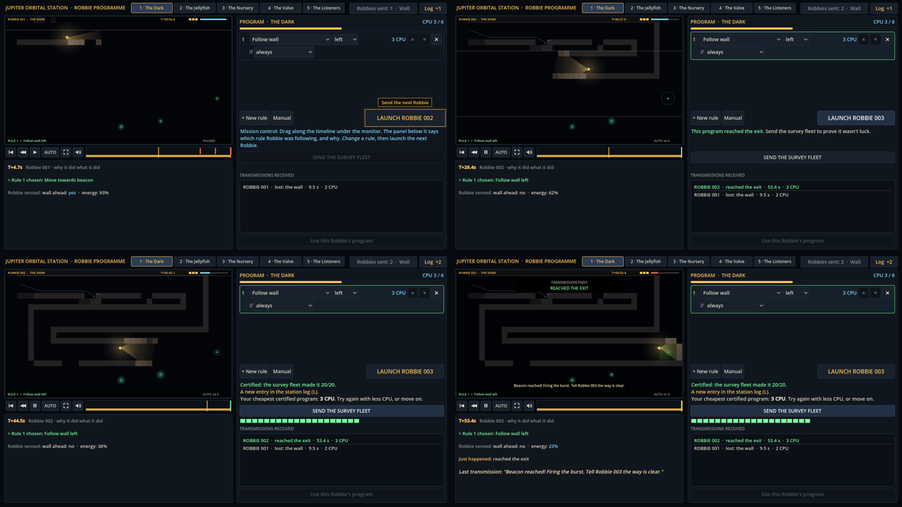

# Block 17 — 2026-10-17, 17:27 UTC: a scripted first-time player in a real browser; a website zip

Albert asked for a link to play and for the game on his Cloudflare. While preparing that, I made the web build into
a plain static website, and then played it the way he will: in a browser, with mouse clicks.

## A website for any host

`tools/site.sh` turns the packed web build into a folder that works on any static host (Cloudflare Pages, Netlify,
anything): `index.html`, the scripts, and a `_headers` file. Every file stays under Cloudflare Pages' 25 MiB limit,
because the 39 MB engine ships gzipped inside `engine_data.js`. The zip goes to the outputs folder for Albert to
upload. I can't upload it myself yet: this session isn't connected to his Cloudflare account.

## A first-time player, scripted

`tools/web/playtest.py` serves that folder, opens it in headless Chromium and plays the first room like a newcomer
would:

1. Launch the starter program.
2. Drag along the timeline.
3. Open the order dropdown and pick "Follow wall".
4. Launch Robbie 002.
5. Send the survey fleet.

It all works in the browser: the dropdown opens and picks, Robbie 002 reaches the exit, and the fleet of 20 comes
back in about six seconds and certifies The Dark.

It found two things a real player would have tripped over:

- **LAUNCH moved.** The status text under the LAUNCH row is one to three lines long, and the survey strip appeared
  and disappeared, so the LAUNCH button jumped up and down between turns. My first scripted click missed it. Now the
  status always keeps room for three lines and the strip always takes its space, so the button stays put.
- **The Why? panel didn't notice edits.** After changing a rule while a replay was paused, the panel didn't show its
  "this Robbie ran a different program" note until the playhead moved. It refreshes on every edit now.

## Also

- Smoke test, webcheck and 36 tests green.
