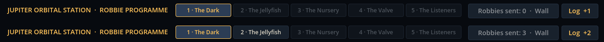

# Block 18 — 2026-10-17, 18:39 UTC: rooms open one after another

## Why

All five rooms were open from the first minute. A newcomer could start in The Valve, which needs conditions they've
never seen, and skip the rooms that teach the pieces. It also undercut the station log, whose entries are meant to
arrive in order as rooms are certified.

## What changed

- **Progression.** The Dark is open from the start. Each next room opens when the one before it is certified. Locked
  tabs are dimmed and say "Locked: certify The Dark to open it". A room that already has Robbies in it (an older save)
  stays open.
- **The news, in one line.** After a certification the status reads "Certified: the survey fleet made it 20/20. The
  Jellyfish is open. New in the station log (L)." It's all one line, so the LAUNCH row doesn't move.
- **A tester's switch.** Ctrl+Shift+U opens every room for the rest of the session (not saved), for Albert or anyone
  playtesting a particular room.

## Also

- Solver records refreshed under the 20-dive survey: The Jellyfish 3, The Nursery 6, The Valve 8 (`stop if valve_shut`
  / `keep_distance 4` / `move 90`, one cheaper than ours by steering east instead of at the beacon), The Listeners 5.
  The Dark is still being re-checked.
- `tools/deploy_cf.sh` is ready for Albert's Cloudflare Pages once the credentials are in the cloud environment.
- A test for the progression; 37 tests, smoke test and webcheck green.
