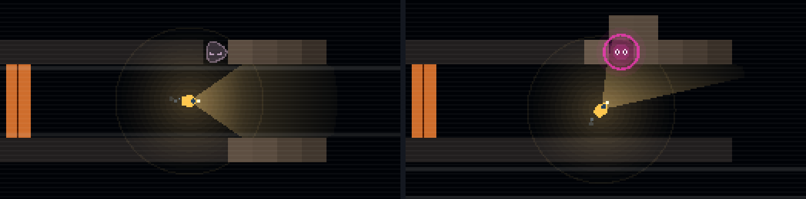

# Block 19 — 2026-10-21, 14:08 UTC: Albert's notes, part 1 (the lurker, CPU, watching)

The hourly blocks are back after the pause. Albert's 14 playtest notes come first now
(docs/design/feedback-2026-10-17.md). This block takes the three that were quickest to fix and most in the way.

## #14 "I can't get past the lurker… Robbie simply doesn't see him"

That's by design: the lurker is camouflaged and can't be sensed until it wakes. But the game never said so, and
nothing on screen showed it either, so it read as a bug. Three fixes, without changing the sim:

- **You can see it before Robbie can.** A sleeping lurker inside the lamp's glow or ahead in the beam now shows as a
  lump in the rock that isn't quite rock: a bumpy outline and two closed eyes. When it wakes, its eyes open, a ring
  pulses round it, and only then does Robbie sense it. A lurker that has just struck rests with half-shut eyes.
- **The hint says so.** The first hint after a lurker strike now reads: "Something in the rock struck that Robbie.
  Lurkers are camouflaged: Robbie can't sense one until it wakes and its eyes glow, a moment before it strikes." The
  second suggests keeping a distance from what Robbie senses, and notes that a lurker needs a while to recover.
- **The manual says so.** "Hostile near" now ends: "Camouflaged creatures (lurkers) can't be sensed until they wake."

## #8 The CPU budget is too tight

Every room's budget went up by roughly half: The Dark 6 → 10, The Jellyfish 8 → 12, The Nursery 8 → 12, The Valve
10 → 16, The Listeners 7 → 12. There's room to write a clumsy program that works, and then make it lean. The
"cheapest known" record on each room still shows how lean it can get. Later, CPU becomes something you upgrade in
the Lab (note #1).

## #2 Watching a launch

- **Launching goes full screen.** The transmission fills the window. Click the picture or press F to go back to
  Mission Control; when the transmission ends, a line says so.
- **Skip ahead (K, on by default).** If the Robbie before this one was lost, the replay runs at x8 until three seconds
  before where it was lost, then plays at your chosen speed. The amber skip button in the transport row turns it off.
- **Speed keys.** Left/Right step through x0.5, x1, x2, x4, x8 and AUTO. Comma and full stop step one second back or
  forward. Space still pauses.

## Also

- The tour in the smoke test now checks the full-screen launch, and has a new shot for the sleeping lurker.
- 37 tests, smoke test and webcheck green.

## Next

From Albert's list: #11 (everything hidden until the lamp finds it, the exit too), #4 (a big, obvious objectives
button), and a light guided first room (#3).
