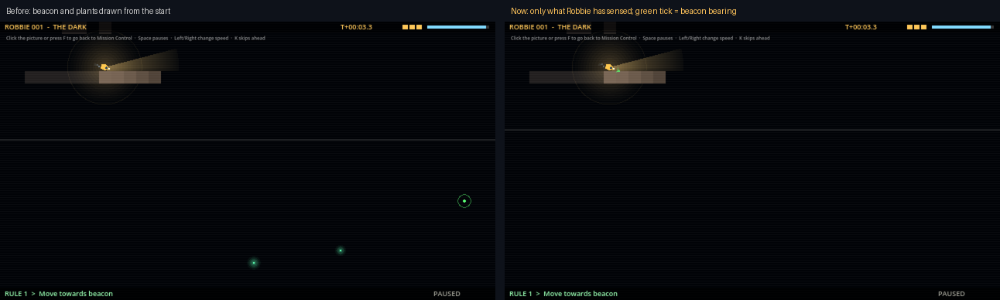

# Block 20 — 2026-10-21, 15:24 UTC: nothing shows until Robbie finds it (Albert's #11)

## Why

Albert: "EVERYTHING should be invisible unless you discover it with your lantern. That includes beacons and
enemies." Until now the rock was already hidden, but the beacon, glowing plants and the valve were drawn from the
first frame, and the jellyfish showed faintly even across the room. The transmission showed more than Robbie knew.

## What changed

- **The picture shows only what Robbie sensed.** It uses the same rules as Robbie's sensors: the lamp's beam, a
  creature's own glow when it's close, and anything near enough to feel. The replay works this out once from the
  recording with a new `World.sensed_from()`. A new test checks it gives the same answer as the sim on every tick of
  five real dives, for every creature.
- **Losing track.** When Robbie stops sensing a creature, a faint ring fades where it was last sensed. The ring
  doesn't follow the creature: Robbie doesn't know where it went.
- **Finding things.** A small ring opens where a creature, plant or the exit is found for the first time. Plants,
  the valve and the exit stay on the chart once found. Later Robbies see them faintly, like the rock.
- **The beacon's bearing.** Robbie always knows which way the beacon is (it's a radio signal), never how far. A small
  green tick beside Robbie points at it. "Move towards beacon" still works exactly as before.
- **The sleeping lurker** still shows as a lump in the rock when the lamp falls on it (block 19), and nothing else
  of it shows until it wakes.
- **The manual** has a new section, "What the transmission shows", and the help for "Move towards" mentions the tick.

## Also

- Replay setup time barely moved (73–206 ms natively per dive).
- 40 tests (3 new), smoke test and webcheck green. Solver records refreshed.

## Next

Albert's #4 and #3: a big, obvious objectives button, and a light guided first room.
