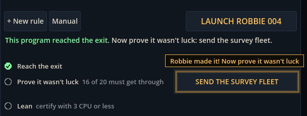

# Block 21 — 2026-10-21, 16:38 UTC: room goals and a guided first room (Albert's #4 and #3)

## Why

Albert: "It was really hard for me to discover the button for 'Send fleet'. I think it should be big and obvious.
Anyway, we really need a tutorial." The survey button was a plain grey bar under the status text. Nothing on screen
said what a room asks of you, and the first-visit guide stopped after the second launch.

## What changed

- **Room goals, always in view under LAUNCH.** Three goals, each with a ring that fills in green when it's done:
  1. *Reach the exit.* Until it's done, a dim note says the green tick points the way.
  2. *Prove it wasn't luck: 16 of 20 must get through.* The survey button now sits on this row, bigger. When the
     program in the editor has just reached the exit, the button turns amber and glows. The strip of 20 squares sits
     just under it.
  3. *Lean: certify with N CPU or less.* N is the cheapest program the station's simulator has certified. This is
     the first of the optional goals from Albert's #5; others (and their rewards) come with the currencies.
- **A guided first room.** In The Dark the guide now points at the one thing to do next, all the way through:
  LAUNCH; "Robbie was lost. Drag along here to see why"; "Robbie can't swim through rock. Change the order, or add a
  rule"; LAUNCH again; "Robbie made it! Now prove it wasn't luck" on the survey button; "Certified! The next room is
  open" on The Jellyfish's tab. After each loss it asks again: look, then change. It finishes when you move on to the
  next room.
- **New station.** A "New station..." button in the manual (H) erases everything and starts again in The Dark with
  the guide, after asking. Albert has already finished The Dark, so this is how he can see the guide.
- **Smaller fixes.**
  - The certified message is shorter, so LAUNCH doesn't move.
  - Leaving full screen puts the picture back under the guide's labels. They were hidden behind it.
  - The Dark now has a solver record: 3 CPU, `follow_wall left`, the same as ours.

## Also

- 40 tests, smoke test and webcheck green.

## Next

Albert's #10: many more last words, by cause and circumstance. Then #5 (the beacon opens the next room; optional
goals pay currency), which needs his answer on the two currencies.
