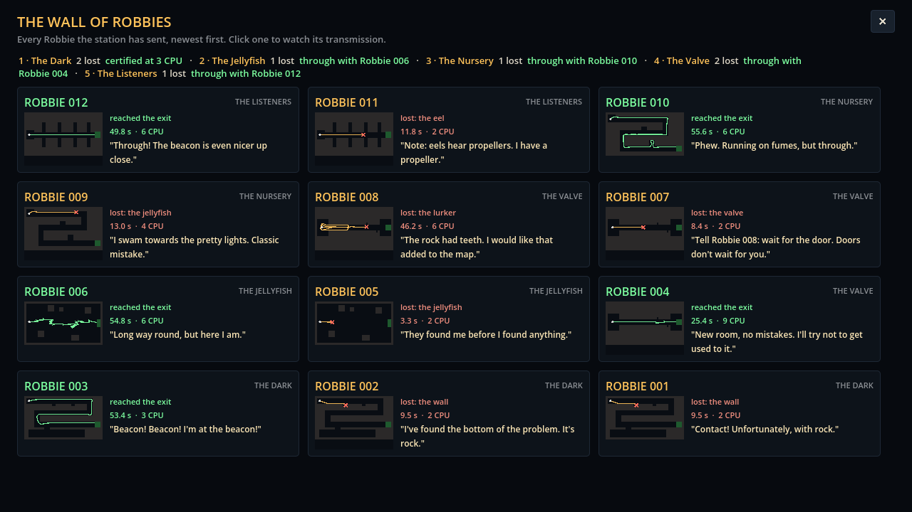

# Block 22 — 2026-10-21, 17:53 UTC: hundreds of last words (Albert's #10)

## Why

Albert: "Love the messages from Robbie. Every time he dies he should send a personalised message, chosen according to
how he died. We should write hundreds of them so they rarely repeat. Reading them is a little reward." There were
66 last words, eight per cause, and they started repeating within a few Robbies in a room.

## What changed

- **340 last words.** Each cause (rock, jellyfish, lurker, valve, eel, energy, waiting too long) has about twenty
  general lines. There are also lines for circumstances, either for one cause or for any:
  - the first Robbie in a room, and the fifth loss in a row;
  - lost within sight of the exit;
  - lost in the first few seconds, or after a long swim;
  - lamp off, holding still, or low on battery;
  - fired the laser;
  - hurt earlier and kept going.

  Getting through has its own: first try, finally (after many losses), on the last of the battery, in the dark,
  dented.
- **Chosen to fit.** A Robbie's lines for this cause in this circumstance are the most likely pick. Lines for the
  circumstance alone come next, then the cause's general lines, and now and then a nod to the Robbie before it.
- **Rarely repeated.** A Robbie never sends what an earlier Robbie already said, anywhere in the station, while
  anything else fits. Lines that differ only in a Robbie's number count as the same. Each Robbie's last words are
  chosen once, at launch, and kept: a rewatch says the same thing, and so does the Wall.
- **Fixes.** Two old lines read "Same the wall as Robbie 006". Lines that name the previous Robbie or what got it
  now say that properly.
- **Tests.** Every line fits a caption (80 characters) and uses only known placeholders. Thirty Robbies lost to the
  same wall send thirty different messages. The circumstances are detected on real dives.
- **A tool to read them in context.** `tools/voice_sample.gd` prints what a run of Robbies would say over a few
  typical dives.

All the lines are in `game/content/voice/lines.json`. Albert can rewrite, add or delete them; the file explains the
keys.

## Also

- 43 tests, smoke test and webcheck green.

## Next

Albert's #5 (the beacon opens the next room; optional goals pay currency) needs his answer on the currencies. Until
then: the best item from the backlog.
