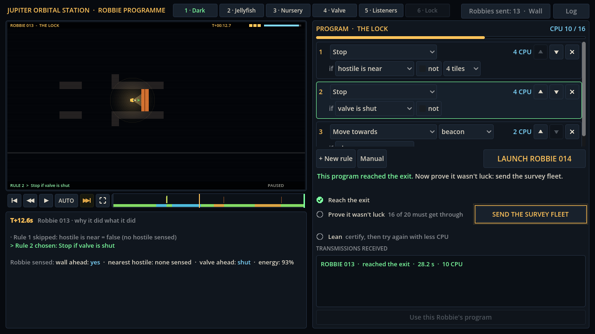

# Block 23 — 2026-10-21, 19:05 UTC: a sixth room, The Lock

## Why

Albert hasn't answered the currency question yet, so #5 waits. The best backlog item was a room that combines two
creatures the player already knows. Every room so far teaches one idea; a sixth room asking for two at once tests
whether the earlier lessons stuck, and it's good level design (#12) to build on what the player has learned.

## What changed

- **The Lock** (room 6). A corridor through a valve, crossed by eel shafts: a wide one with two eels before the valve,
  and two more after it. Each earlier room's answer fails here on its own:
  - The Valve's (back away from danger, wait for the door): backing away is noise, and the eels hear it. 5/20.
  - The Listeners' (hold still while an eel is near): nothing waits for the valve, and Robbie is crushed. 8/20.
  - Waiting for the valve alone: Robbie swims straight past the eels. 8/20.

  Both together pass 18/20: hold still while an eel is near, hold still while the valve is shut, then swim for the
  beacon. Twice an eel stays in range and Robbie waits until its battery runs out, which leaves room for a better
  program than ours.
- **Hints** for eel and valve losses in The Lock, and a station log entry when it's certified. That entry moves the
  story on a little.
- **Six tabs.** Room names on the tabs drop the "The" so all six fit.
- The solver and the records include The Lock. Its exploit hunt starts now.

## Also

- docs/design/rooms.md has The Lock's map and the table of programs.
- 43 tests (the reference-program test covers The Lock's five programs), smoke test and webcheck green.

## Next

Albert's #5 once he picks the currencies. Meanwhile: the hunt and solver on The Lock; the keep_distance-backs-into-
rock issue (it shows up here too: 9 of The Valve's answer's 15 losses were rock).
