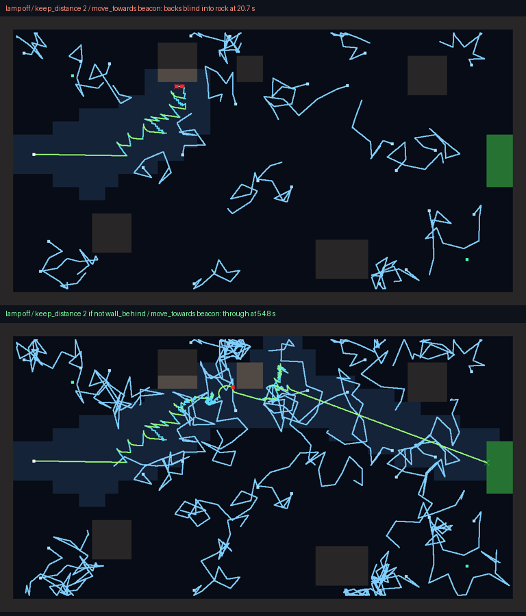

# Block 24 — 2026-10-21, 20:18 UTC: "wall behind"

## Why

Albert still hasn't answered the currency question, so #5 waits. The backlog had a known flaw. `keep_distance`
backs Robbie away from danger while it faces the danger, so it backs away blind. In The Jellyfish that sometimes
means backing into rock: 2 of 20 dives for the careful program. In The Lock it was 9 of the 15 losses for The
Valve's answer. Robbie had no way to know.

## What changed

- **A new condition, "wall behind"** (1 CPU). There is rock, or a shut valve, just behind Robbie: it can't see
  behind, but it can feel it with its tail. It mirrors "wall ahead", looking in the direction keep_distance backs
  away.
- **It's a tool, not a fix.** Nothing about existing dives changed, and no goldens changed.
  - In The Jellyfish, `keep_distance 2 if not wall_behind` helps the careful program: over 40 dives, its 3 losses to
    rock become 1. It's now one of the room's reference programs.
  - In The Valve it makes things worse (17/20 against 20/20). A Robbie that stops backing away at the rock is still
    in front of the lurker. Knowing when to use it is the puzzle.
- **Help text.** The editor tooltip, the manual and keep_distance's own help mention it.
- **Tests.** The condition mirrors "wall ahead" next to The Dark's west wall, and it costs 1 CPU.

## Also

- The Lock's exploit hunt has checked its first 350 programs. The four that passed on three seeds fail the survey
  (3/20 and 5/20), so there are no shortcuts so far.
- The solver's cheapest certified program in The Lock is 9 CPU: it steers east instead of at the beacon.
- 45 tests, smoke test and webcheck green.

## Next

Albert's #5 once he picks the currencies; otherwise the backlog (jellyfish turning smoothly; three-rule hunts).
