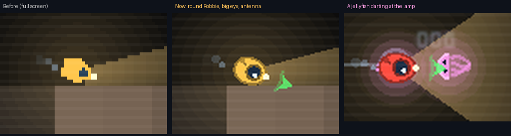

# Block 25 — 2026-10-21, 21:27 UTC: a cuter Robbie, rounder jellyfish, a sharper full screen

## Why

Albert's notes #7 ("the graphics are too simple"), #9 ("everything should be more cute") and #13 ("it can't all be
blocky", "everything that moves") are waiting on the art pipeline (Vertex AI). Some of it doesn't need to wait. The
full-screen transmission was the small picture doubled, so every shape was made of chunky pixels. Robbie was a yellow
pentagon. The jellyfish were dots that changed direction in sharp zigzags.

## What changed

- **Full screen at full resolution.** The transmission now draws at 1280x720 when it fills the window, instead of
  doubling the 640x360 picture. Curves and text are smooth.
- **Robbie** is round, a little longer in front, with one big porthole eye and a glint. Two small fins at the back
  paddle while it swims. A radio antenna's tip blinks red with the transmitter. The lamp at its nose goes dark when
  the lamp is off.
- **Jellyfish** have a bell that pulses as they swim (faster when they dart), two dot eyes, and four tentacles
  swaying behind. They swim bell-first and float bell-up when they barely move. Their drawn path is smoothed over a
  fifth of a second, so they drift in curves instead of zigzags. That's only the picture: the sim, sensing and
  collisions are unchanged, and no golden replay changed.

## Also

- The smoke tour has a new full-screen shot of a jellyfish darting at the lamp.
- 45 tests, smoke test and webcheck green.

## Next

Albert's #5 when he picks the currencies. Meanwhile, more of the same: the eel and the lurker, the beacon, plants
and rock edges that aren't square.
