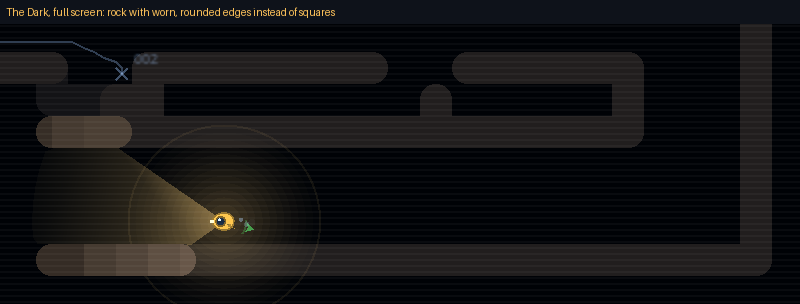

# Block 26 — 2026-10-21, 22:36 UTC: rock that isn't square, anemones, a beacon buoy

## Why

More of Albert's #13 ("it can't all be blocky") and #9 ("more cute"), still without the art pipeline. After block 25
Robbie and the jellyfish were round, but the rock was still a grid of squares, the glowing plants were dots, and the
beacon was a dot in a ring.

## What changed

- **Worn rock.** Every rock tile is drawn as a disc joined to its rock neighbours by bands. Solid rock stays solid;
  outer corners come out round (half a tile) and single-tile walls read as smooth ridges. The same goes for the
  station's chart, the patches lit by the lamp, and the exit's glow. Collisions are unchanged: the round corners only
  trim the picture inside the tile Robbie would hit.
- **Anemones.** Glowing plants are small anemones seen from above: six fronds swaying, a bright bead on each tip.
  The faint chart shows them still.
- **A beacon buoy.** The beacon is a little six-sided buoy whose lamp flashes with each ping, with two rings
  spreading out of step.

## Also

- The Lock's exploit hunt passed 3,700 programs; none passes the survey so far.
- 45 tests, smoke test and webcheck green.

## Next

Albert's #5 once he picks the currencies. Then the eel and the lurker get the same treatment, and maybe a slow
drift of particles in the water so the dark isn't empty.
