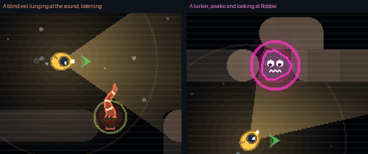

# Block 27 — 2026-10-21, 23:43 UTC: the eel and the lurker, and marine snow

## Why

More of Albert's #7/#9/#13 without the art pipeline: the eel was a thick wavy line and the awake lurker was a ring
with two dots. Neither matched the new Robbie and jellyfish. The water was empty black.

## What changed

- **The eel** has a body that tapers from a round head to a thin tail along a wavy spine, with three glowing stripes
  across it. Its eyes are closed, two little curves, because it's blind. When it lunges, its mouth opens and arcs
  spread ahead of it: it's listening.
- **The lurker, awake,** is the rock it pretended to be: a lumpy body with two big eyes that follow Robbie and a
  zigzag of teeth, inside its pulsing ring. Asleep and resting, it's still the lump with closed or half-shut eyes.
- **Marine snow.** Specks drift slowly down through the water, seen only where Robbie's lamp lights them, so the
  beam and the glow around Robbie read as light in water. It's only decoration: nothing in the sim.

## Also

- The smoke tour has full-screen shots of the eel and the lurker.
- The Lock's hunt is past 4,700 programs; none passes the survey so far.
- 45 tests, smoke test and webcheck green.

## Next

Albert's #5 once he picks the currencies. The drawing pass could go on (the valve, the laser, the station screens),
but the station screens are #6's job (three screens), which needs Albert's go-ahead on the Lab.
