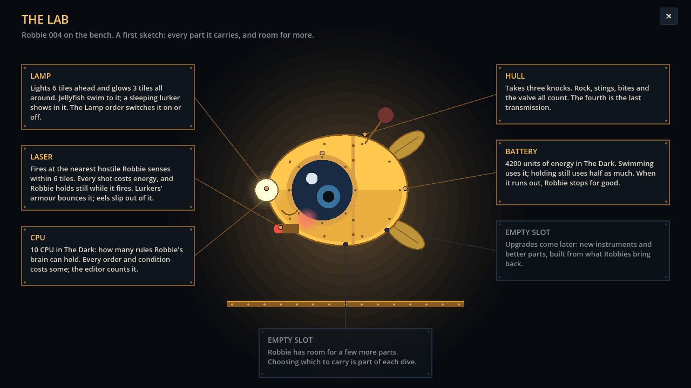

# Block 28 — 2026-10-22, 00:50 UTC: the Lab, a first sketch (Albert's #6)

## Why

Albert's #6: three screens, Game, Mission Control and the Lab. "The Lab is where we upgrade: a cute sprite of our
current Robbie in big size... Robbie has limited slots, so you choose between purchased / discovered components for
each mission. Cute, steampunky." Game (the full-screen transmission) and Mission Control exist. The Lab needs his
decisions on the currencies before anything can be bought, but a sketch gives him something to react to.

## What changed

- **A Lab button** in the station header (key B, for bench). The Wall button is shorter ("Wall · 12 sent") to make
  room.
- **Robbie on the bench**, big and drawn in the style of the dive view, but brass and riveted:
  - a round hull with a brass band and rivets;
  - a porthole eye whose pupil looks about, with a shy blush and a small smile;
  - paddle fins;
  - a glowing nose lamp, the laser under its chin, and an antenna that blinks;
  - it bobs gently.
- **A card for each part it carries**, joined to the part by a brass leader line:
  - LAMP and LASER (what they do and to whom);
  - HULL (three knocks);
  - BATTERY and CPU (this room's numbers).
- **Two empty slots**, greyed: "Upgrades come later: new instruments and better parts, built from what Robbies bring
  back." Nothing to buy yet.

## Also

- The smoke tour has a shot of the Lab.
- 45 tests, smoke test and webcheck green.

## Next

Albert's reaction to the Lab, and his answer on the currencies (#5, #1). Until then: smaller items from the backlog.
