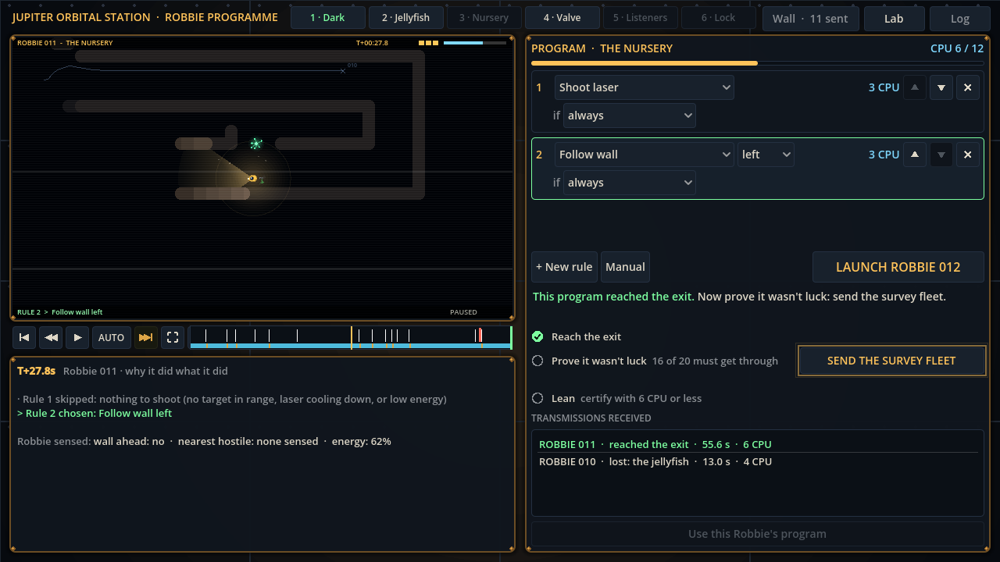

# Block 29 — 2026-10-22, 01:59 UTC: a browser playtest, a lamp bug, brass for Mission Control

## Why

With Albert's decisions still pending, two jobs that don't need them: replay the first-time player in a real
browser against the current build (much has changed since it was written), and make Mission Control feel less like a
web page (Albert's #7), to match the Lab.

## What changed

- **The browser playtest** (tools/web/playtest.py) follows the new flow:
  - launch, full screen, the transmission plays out, F back to Mission Control;
  - scrub, change the rule, launch again;
  - the glowing survey button, the certification, the Lab (B), the Wall (W).

  It also says where in the run any console error appeared. The whole loop works in Chromium.
- **A lamp bug.** The playtest caught "Invalid polygon data, triangulation failed". Pressed against rock, every lamp
  ray stops at once and the lit cone folds to nothing, which the renderer can't fill. The view now skips a cone with
  no area. Two lurker lumps and the Lab's fins repeated their first point, which can trip the same check; fixed too.
  The smoke test now fails on this error.
- **The eel's body** is drawn as overlapping discs along its spine, not one polygon: a waving polygon could fold over
  itself.
- **Brass for Mission Control.**
  - The main panels have brass edges, rounded corners, a soft shadow and a rivet on each corner, as in the Lab.
  - Behind them, dark hull plates with seams and rows of rivets, and a faint warm glow from the middle, so the
    station reads as a place.

## Also

- 45 tests, smoke test, webcheck and the browser playtest green.

## Next

Albert's reactions (the Lab, the currencies). The art pass proper needs his references and Vertex AI.
