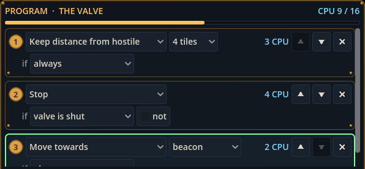

# Block 32 — 2026-10-22, 05:37 UTC: brass rule cards

## Why

The rest of Albert's #7 pass for Mission Control: the program editor's rule cards were still the old flat blue-grey
boxes inside the new brass panels.

## What changed

- **Rule cards** have a dark plate with a brass edge and a rivet at each bottom corner. The rule driving Robbie at
  the replay's moment still lights up with a green edge.
- **The rule number** sits on a round brass badge.
- The dropdowns are unchanged and still readable; the browser playtest runs clean.

## Also

- 51 tests, smoke test, webcheck and the browser playtest green.

## Next

Albert's yes on docs/design/progression.md, then step 1 of it.
