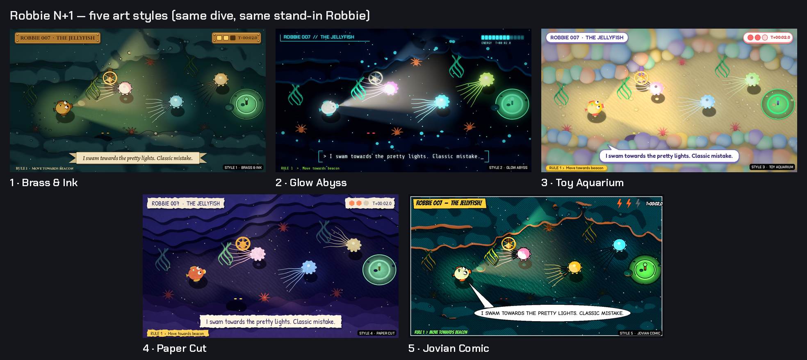

# Session 35 — 2026-10-24: on GitHub, native builds, art pass begins

## Why

First Claude Code session. Albert moved the project onto GitHub, asked for the game as native apps (an APK for his
Android tablet and an EXE for Windows) instead of the browser, and made the art pass the priority. We weighed moving
to Unity and stayed on Godot: the game is text and logic that Godot handles easily, Godot exports both targets, and
it runs well in a cloud machine with no screen or GPU.

## What changed

- **Migration:** the Cowork bundle pushed to https://github.com/Dargeron/Claude-Robbie-N-1 with full history
  (`main` at 922097f, plus s01-dive-view, s01-tuning, s02-station).
- **Android:** a new export preset (arm64, landscape either way up, immersive) and `tools/android.sh`, which installs
  what it needs through `tools/export_setup.sh` (export templates and the Android build tools) and signs with
  Robbie's release key from the environment. The key lives in Albert's Google Drive, never in the repo.
- **Windows:** the existing preset, unchanged; `tools/export_setup.sh --desktop-only` installs its templates.
- **Blender** 5.2.3 runs headless here: a 960×540 frame with murky-water volumetrics renders in about 90 s on the CPU.

- **Art pass, step 1:** an art toolkit for Blender (`tools/art/`) that renders scenes to look drawn: flat colour
  bands, ink outlines and Robbie's lamp computed in the shader, so frames converge fast on a CPU. With it, five style
  concepts of the same dive with each style's UI (docs/art/concepts/) and five very different Robbies, each with its
  Lab view and its top-down game sprite (docs/art/robbies/). See docs/art/README.md.

## Also

- 51 tests and the smoke test green. The APK was checked with aapt2 and apksigner but not yet run on a device:
  Albert's tablet is the first.

## Next

Albert picks one style and one Robbie. Then: Robbie's sprite (top-down, turning in 16 directions) and the Lab's big
Robbie with swappable parts, the dive backgrounds, and the UI in the chosen style.
