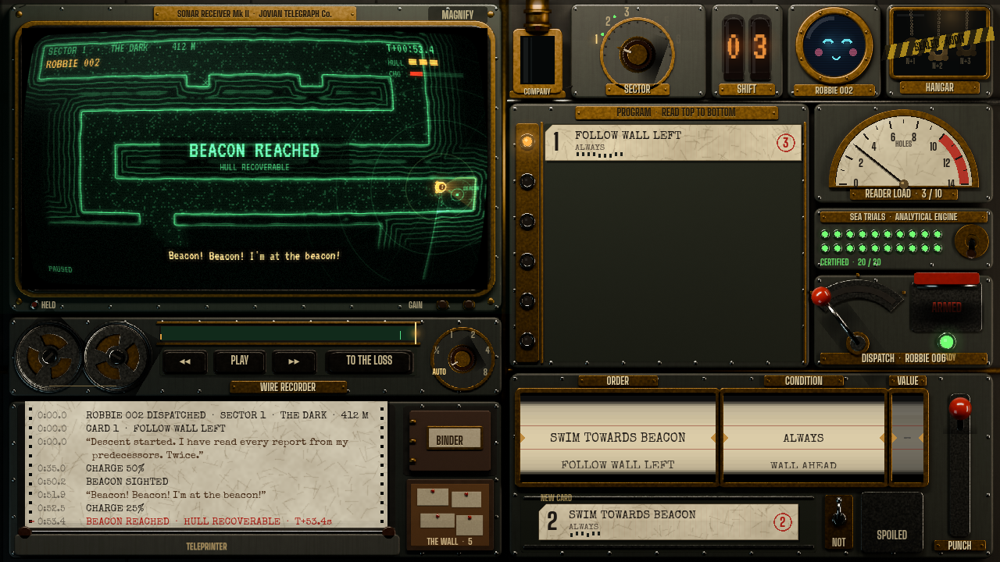

# Session 36 — 2026-10-25: the operator's console, first playable prototype

## Why

Albert chose the art (Bathy + Dead Air) and accepted the console proposal in full: punch cards and a keypunch, shifts
with Company memos and a tally, the Company as antagonist. He asked for the first real prototype, with art more
polished than the mock-ups, everything touchable and movable, and only the first three sectors, leaning darker, more
political and more cynical, with Jeff VanderMeer's Company (*Borne*, *Dead Astronauts*) as the reference. The plot:
Robbie's consciousness and freedom, and the intelligence in Jupiter's depths, against the all-powerful Company. He
also asked for ideas for the Lab, written down but not built.

## What changed

- **The console is the game** (`game/console/`, main scene). One desk, nothing floats over it except paper:
  - **Sonar receiver**: the dive drawn live in the Dead Air look (`sonar_view.gd`, `sonar_terrain.gdshader`): rock
    as contoured masses with a bright wall return, only where Robbie has listened; a sweep, range rings, contacts as
    green echoes numbered C-1, C-2...; Bathy as an amber glyph in sixteen headings with his lamp as an amber wedge;
    when he is lost the picture drowns in static (dead air). Shown through a CRT shader (`crt.gdshader`): curvature,
    bloom, scanlines, roll bar, tears. Tap it (or MAGNIFY) for the whole screen.
  - **Card rack** with pilot lamps (amber: running; red with the reason stamped: skipped; dark: never reached).
    Drag cards to reorder, into SPOILED to bin them, back to the keypunch to repunch; tap to load.
  - **Keypunch**: order drum, condition drum, value wheel, NOT switch, PUNCH lever; the card in the bed shows the cost.
  - **Reader load gauge** (CPU), **dispatch lever** under a red safety cover, **sea trials** on the analytical
    engine (a crank and twenty lamps; tap a red lamp to watch that trial).
  - **Wire recorder** (drag the reels or the wire, keys, speed knob) and **teleprinter** (the dive typed as it plays;
    tap a line to wind there; pull the strip up to tear it off).
  - **Company tube** (memos in brass capsules), **sector dial**, **shift nixies**, **Bathy's mood porthole** (calm,
    curious, worried, scared, hurt, happy, dim, static), **hangar window** (sealed for audit).
  - **Paper**: Company memos and shift tallies, Op. 5's letters, the binder (orders, conditions, regulations, Op. 5,
    and the contract, which starts over), and **the Wall**, a corkboard of torn tapes.
- **Shifts**: one per sector. Each opens with a memo and new type plates for the drums (shift 1: swim, follow wall,
  wall ahead; shift 2: lamp, keep distance, hostile near, NOT...; shift 3: the laser...), and closes with a tally
  that charges lost hulls to your contract. Op. 5's notes are the tutorial; his letters carry the plot.
  Words in `game/content/story/console.json`.
- **Art**: the desk plate and moving parts rendered in Blender with physical materials (`tools/art/console_scene.py`,
  2x resolution), placed from one shared layout (`game/content/console_layout.json`). Twelve new synthesised machine
  sounds (drum clicks, punch, lever, tube thump, tearing paper, teleprinter...).
- **Tests**: 57 (6 new in `test_console.gd`), and `tools/console_check.sh`: the screenshot tour plus a touch
  play-through that drives the console with taps and drags only (31 checks).
- **The Lab**: ideas only, in `docs/design/hangar-ideas.md` (the Compliance Governor, requisition forms, the pattern
  press, the deep's parts). Waiting for Albert.

## Next

Albert playtests the APK. Then iterate on what he finds; the Lab once he has read the ideas.
