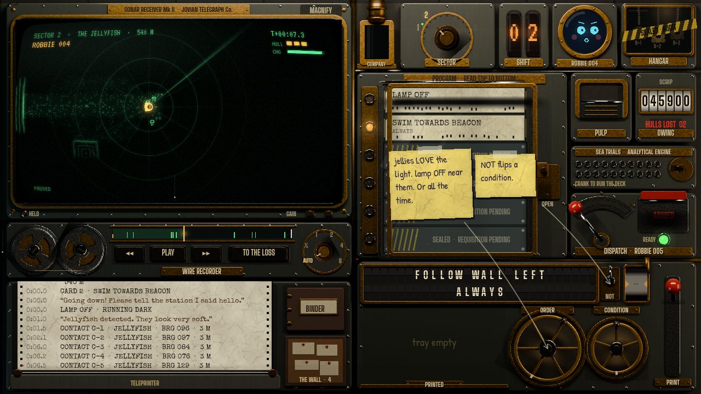

# Session 37 — 2026-10-25: the card press, slots, and three looks to choose from

## Why

Albert playtested 0.1.0 (the console prototype). His notes: cards should all cost the same, with a limited number
of slots, two to start; there was no intuitive way to discard a card; the desk felt "a bit too clean... bland"
(3D, or another style?); and everything should be more of a machine: choose with a turning wheel, cards printed out
of a machine, put in in order, a glass lid to close, more interaction and animation.

## What changed

- **Slots instead of CPU.** Rooms have a `slots` count (2, 2, 2 for the first three sectors; 3, 3, 4 later). The
  console no longer uses CPU at all; the sim and its costs are untouched, so golden replays are unchanged. A new test
  checks each sector has a certifying reference program within its slots.
- **The card press** (`game/console/press.gd`, `flaps.gd`): an ORDER wheel and a CONDITION wheel turned by their
  grips (or tapped either side), a split-flap board that clatters to the card's text, the NOT switch, a value wheel,
  and a PRINT lever. The press stamps and vents steam; the card slides out into a tray.
- **The card table** (`card_table.gd`): the tray, the reader's slots (the rest sealed, "requisition pending") under
  a hinged glass lid with condensation and the lamp's reflection, which must be shut to dispatch; cards dragged
  between tray and slots; the PULP chute that shreds what's dropped in it. Anywhere else, a card slides back.
- **The Company's counter** (`counter.gd`): the debt on rolling number wheels, and hulls lost.
- **Ambience** (`ambience.gd`): steam from the press, leaking pipes, condensation down the seams, the lamp stuttering.
- New plate and parts rendered in Blender (two selector wheels, the lid's frame, the chute's flap); tutorial notes,
  memos and binder text follow the new rules (no CPU anywhere).
- The touch play-through now turns the wheel by its grip, pulls PRINT, lifts the lid, pulps a card, inserts one,
  is refused with the lid open, shuts it and dispatches: 33 checks, all passing.
- **Art direction mock-ups** (`docs/design/art-direction.md`, `docs/art/direction/`): A, the console in 3D from the
  operator's chair (`tools/art/mock_3d.py`, built from the same geometry with the game's own screen contents mapped
  on); B, the flat desk lived-in (`console_scene.py ... grimy`, then `tools/art/weather.py`), shown in the game
  itself; C, inked like a graphic novel (`tools/art/ink.py`). Recommended: A with B's weathering.

## Next

Albert's playtest of 0.2.0, and his pick of A, B or C. Then the hangar, once he has read its ideas.
